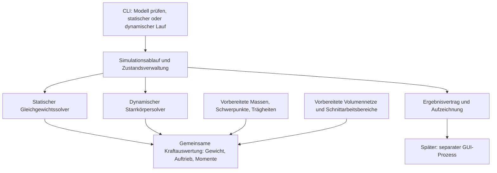

# Spezifikation Hydrostatikkern: statische und dynamische Berechnung

## 1. Status, Zweck und Abgrenzung

**Stand: 26.10.2026.** Auf Nutzerauftrag aus dem gemeinsam besprochenen
Spezifikationsvorschlag übernommen. Die Anforderungen A-C-00004 bis
A-C-00029 sowie A-C-00031 und A-C-00032 beschreiben den fachlichen und
technischen Zielumfang. A-C-00030 steht im Thema Modellbeschreibung.
Die Spezifikationsaufnahme allein belegt keine Implementierung oder Abnahme.
Technische Umsetzung und Tests sind inzwischen im unten verlinkten
Plan und Nachweis dokumentiert; die fachliche Gesamtabnahme bleibt offen.
Die Umsetzung wurde inzwischen ausdrücklich beauftragt;
ein Versionsziel oder Git-Auftrag ist damit nicht verbunden.

Dies ist die einzige maßgebliche Spezifikation zum sachlogischen Thema
Hydrostatikkern. Sie beschreibt zuerst einen eigenständig prüfbaren
Core und anschließend dessen Anschlussfähigkeit für eine getrennte GUI.
Sie autorisiert keine Änderungen oder Veröffentlichung im GUI-Projekt.

Die freigegebenen Koordinatenanforderungen A-C-00001 bis A-C-00003 stehen
weiterhin ausschließlich in der
[Spezifikation der Modellbeschreibung](Spezifikation_Modellbeschreibung.md).
Das endgültige Modellformat wird dort fortgeführt; die
[Beispiele](Beispiele_Modellformat/README.md) sind keine normativen
Ersatzanforderungen oder bereits unterstützten Eingaben.

Offene Entscheidungen sind in der
[Entwurfspunkteliste Hydrostatikkern](Entwurfspunkte/Hydrostatikkern.json)
geführt. Die nachfolgenden Abnahmekriterien gelten zusätzlich zu den dort
noch festzulegenden Zahlenwerten und Verfahren. Ohne diese Festlegungen
darf keine vollständige Abnahme behauptet werden.

## 2. Architektur

Die Modulnamen sind Verantwortungsbereiche, keine zusätzliche normative
Datei- oder Klassenhierarchie.

| Bereich | Verantwortung |
|---|---|
| Modellimport | Modell-JSON, Referenzen und Eingaben prüfen |
| Geometrie | Meshprüfung, Massenintegration und Wasserebenenschnitt |
| Physik | Beiträge je Element und Gesamtkraft/-moment |
| Solver | Gleichgewichtssuche und zeitliche Integration |
| Simulation | Laufkonfiguration, Zustand, Zeit, Abbruch und Status |
| Schnittstelle | Ergebnisdaten und Aufzeichnung, später Live-Anbindung |
| CLI | Dünner headless Einstieg ohne eigene Fachlogik |
| Tests | Fachliche, numerische, Vertrags- und Performancenachweise |

## 3. Anforderungen

### 3.1 Umfang und technische Basis

#### A-C-00004: Headless Hydrostatikkern und Ausbaugrenze

Der Core muss ein zusammengesetztes starres Modell ohne GUI statisch
und dynamisch unter Gewicht und hydrostatischem Auftrieb berechnen können.
Die erste Ausbaustufe verwendet ruhendes Wasser mit horizontaler
Oberfläche, konstanter Wasserdichte und konstanter Schwerebeschleunigung.
Modellteile bleiben einzeln identifizierbar, sind aber starr verbunden.

Hydrodynamischer Widerstand, Tragflächenkräfte, Aerodynamik, Wellen,
Wassereinbruch über Lecks oder Teilflutung und bewegliche Gelenke sind
nicht Teil dieser Ausbaustufe. Das vollständige Volllaufen offener
Rümpfe über den Bordrand regelt A-C-00047.
Dynamik mit lageabhängig neu berechnetem hydrostatischem Auftrieb ist
nicht mit einer vollständigen Hydrodynamik gleichzusetzen.

**Abnahme:** Ein statischer und ein dynamischer Referenzlauf sind ohne
Fenster, GUI-Prozess oder GUI-Bibliothek ausführbar. Die Ausgabe benennt
den tatsächlich verwendeten Physikumfang.

#### A-C-00005: Eigenständige C++-Bibliothek mit CLI

Die Fachberechnung muss in einer wiederverwendbaren C++-Bibliothek
implementiert sein. Die CLI verwendet dieselbe Bibliothek wie deren Tests.
Der produktive Rechenpfad darf weder Python noch eine GUI-Laufzeit benötigen.
Python darf für Teststeuerung und unabhängige Referenzrechnungen verwendet
werden. Der Build erfolgt mit CMake; Performancemessungen verwenden einen
dokumentierten optimierten Release-Build.

**Abnahme:** Bibliothek und CLI lassen sich ohne Python-Anbindung bauen
und betreiben. Derselbe Referenzfall wird über Bibliothek und CLI mit
übereinstimmenden fachlichen Ergebnissen ausgeführt.

#### A-C-00006: Geprüfte Wiederverwendung vorhandener Implementierungen

Vorhandene Algorithmen und geeignete Datenstrukturen aus SegelPhysik3
sollen übernommen oder fachlich entsprechend umgesetzt werden.
Übernahme, Anpassung oder begründeter Ersatz werden pro Funktionalität
mit Herkunft, Abweichungen und zugehörigen Tests dokumentiert.
Die bisherige Python-/GUI-Kopplung oder das Altformat dürfen dabei nicht
ungeprüft zum neuen Vertrag werden.

**Abnahme:** Für Modellvorbereitung, Masseneigenschaften, Ebenenschnitt,
Hydrostatik, Statik und Dynamik ist die Herkunftsentscheidung nachvollziehbar.
Jeder übernommene Rechenbaustein besitzt Tests gegen den neuen Vertrag.
Ein bloßer Altcodevergleich gilt nicht als unabhängiger Korrektheitsbeweis.

### 3.2 Modellprüfung und Masseneigenschaften

#### A-C-00007: Modellprüfung ohne stille Ersatzwerte

Der Import muss die unterstützten Modellvarianten, eindeutige Element-IDs,
Pflichtangaben, endliche Zahlen, zulässige Parameter und referenzierte
Dateien prüfen. Physikdaten dürfen nicht ersatzweise aus Grafikdaten
gewonnen werden. Nicht unterstützte oder unvollständige Eingaben werden
mit betroffener Element-ID und Fehlerursache abgelehnt.

**Abnahme:** Negative Tests decken fehlende Masse, ungültige Dichte oder
Wanddicke, nicht endliche Werte, doppelte IDs, fehlende Dateien und
ungeeignete Netze ab. Kein Fall führt zu einem stillen Nullwert oder
einem als erfolgreich ausgegebenen Ersatzmodell.

#### A-C-00008: Pflichtmasse und getrenntes optionales Volumen

Jedes Hydrostatikelement muss genau eine unterstützte Massenbeschreibung
besitzen. Unterstützt werden zunächst:

| Variante | Physikalischer Vertrag |
|---|---|
| Punktmasse | Positive Masse und eindeutige Position im Modellbezug |
| Homogener Vollkörper | Positive Dichte und geeignetes geschlossenes Massenmesh |
| Homogene dünne Schale | Positive Dichte, positive Wanddicke und geeignete Materialfläche |

Eine separate optionale Volumengeometrie beschreibt die Wasserverdrängung.
Fehlt sie, gelten exakt 0 m³ Verdrängungsvolumen und kein Auftrieb,
während der Massenbeitrag erhalten bleibt. Ein künstliches Epsilonvolumen
oder ein Ersatz durch Massen-/GUI-Geometrie ist unzulässig.
Die endgültigen JSON-Feldverträge werden im Thema Modellbeschreibung
festgelegt, nicht unabhängig in dieser Spezifikation dupliziert.

**Abnahme:** Eine geometriefreie Punktmasse beeinflusst Gesamtmasse,
Schwerpunkt und Trägheit, aber weder Verdrängung noch Auftrieb.
Jede Massenvariante wird positiv und negativ getestet. Ein Modell mit
fehlender Pflichtmasse wird abgelehnt.

#### A-C-00009: Vorbereitete Gesamtmasseneigenschaften

Elementmasse, Schwerpunkt und Trägheit sowie die Gesamtmasseneigenschaften
müssen aus den freigegebenen Massenverträgen bestimmt werden.
Die Gesamtträgheit enthält die erforderlichen Steiner-Anteile.
Punktmassen besitzen keine Eigentägheit. Konstante Masseneigenschaften
werden außerhalb wiederholter Solverauswertungen vorbereitet.

Der Konstruktionsursprung bleibt gemäß A-C-00003 unabhängig vom
Gesamtschwerpunkt. Für die Dynamik müssen Gesamtmasse positiv und
Gesamtträgheit für die verwendeten Freiheitsgrade geeignet sein.
Eine singuläre Trägheit darf nicht stillschweigend regularisiert werden.

**Abnahme:** Analytische Vollkörper, dünne Schalen und versetzte
Punktmassen prüfen Masse, Schwerpunkt, Trägheit und Steiner-Anteile.
Ungeeignete dynamische Gesamtträgheiten werden ausdrücklich gemeldet.
Vor einer Schalenabnahme ist die Materialflächenkonvention festgelegt.

#### A-C-00010: Gültige Verdrängungsgeometrie ohne Doppelzählung

Zur Volumenintegration verwendete Netze müssen geeignet geschlossen
und orientiert sein. Umfang und Grenzen der Geometrievalidierung
müssen ausdrücklich dokumentiert werden; reine Kantenprüfungen dürfen
nicht als vollständiger Selbstschnittnachweis ausgegeben werden.
Überlappende Verdrängungsvolumina dürfen nicht unkontrolliert addiert werden.
Für die erste Ausbaustufe sind nur überschneidungsfreie
Verdrängungsvolumina zugelassen. Erkannte Überschneidungen führen zur
Ablehnung des Modells mit eindeutiger Diagnose. Eine automatische
Vereinigung oder Reparatur ist nicht vorgesehen.

**Abnahme:** Offene und fehlerhaft orientierte Testnetze werden erkannt.
Für sich überschneidende Körper existieren Tests gegen die festgelegte
Ablehnungsstrategie.
Eine solche Eingabe darf nicht unbemerkt doppelte Verdrängung erzeugen.

### 3.3 Gemeinsame Hydrostatikauswertung

#### A-C-00011: Aktueller Wasserebenenschnitt im Modellbezug

Die Volumennetze bleiben im festen Modellbezug. Die aktuelle Wasserebene
wird entsprechend der Modellpose in diesen Bezug transformiert.
Bei teilweisem Eintauchen sind verdrängtes Volumen und erstes
Volumenmoment für die jeweilige Lage zu bestimmen.
Die Auswertung erfolgt geometrisch genau bezogen auf das verwendete
diskrete Netz und innerhalb nachzuweisender numerischer Toleranzen.

Ein einmaliger Schnitt an einer Entwurfswasserlinie genügt nicht für
veränderte Eintauchtiefe, Krängung oder Trimm. Geglättete
Nassflächengewichte sind kein Ersatz für hydrostatische Volumenmomente.
Vollständig trockene oder vollständig eingetauchte Körper sollen über
geeignete Grenzen erkannt werden, ohne unnötigen Ebenenschnitt.

**Abnahme:** Tests behandeln trockene, teilweise und vollständig
eingetauchte Referenzkörper sowie Ebenen durch Ecke, Kante und Fläche.
Schnellpfade und allgemeine Auswertung stimmen innerhalb festgelegter
Toleranzen überein. Äquivalente Modell-/Welttransformationen liefern
dieselben physikalischen Ergebnisse.

#### A-C-00012: Einheitliche Kräfte und Momente für beide Solver

Statik und Dynamik verwenden dieselbe Auswertung von Gewicht,
Auftrieb und Momenten. Auftrieb folgt aus Wasserdichte,
Schwerebeschleunigung und eingetauchtem Volumen. Sein Angriffspunkt
folgt aus dem ersten Volumenmoment. Bei Nullvolumen wird kein
definierter Auftriebsschwerpunkt vorgetäuscht.

Elementbeiträge und Gesamtsummen müssen eindeutig identifizierbar sein.
Koordinatenframe und Bezugspunkt eines Moments sind verbindlich
festzulegen. Gleiche Beiträge dürfen bei Gruppierung nicht mehrfach zählen.

**Abnahme:** Analytische Referenzen prüfen Volumen, Auftriebsschwerpunkt,
Kraft und Moment. Die gemeinsame Auswertung liefert für dieselbe Pose
in beiden Solverpfaden übereinstimmende Ergebnisse. Ein Nullvolumenfall
liefert Auftrieb null und keinen irreführenden Angriffspunkt.

### 3.4 Statische und dynamische Solver

#### A-C-00013: Statisches Gleichgewicht

Der statische Solver sucht Z-Lage, Krängung und Trimm eines schwimmenden
Gleichgewichts. X, Y und Kurs sind zunächst vorgegeben.
Kraft- und Momentenresiduen besitzen getrennte Abnahmetoleranzen.
Ein Iterationslimit allein begründet keinen Erfolg.

**Abnahme:** Symmetrische und asymmetrisch beladene Referenzfälle
erreichen die festgelegten Residuen. Ergebnis und Status unterscheiden
Konvergenz, fehlende Konvergenz und nachgewiesene Unlösbarkeit.
Eine über der maximalen Tragfähigkeit liegende Masse wird nicht mit
einer beliebigen Lage als schwimmendes Gleichgewicht ausgegeben.

#### A-C-00014: Dynamische Starrkörperrechnung

Der dynamische Solver integriert Translation und Rotation des starren
Gesamtmodells unter Gewicht und aktuellem hydrostatischem Auftrieb.
Die Orientierung wird intern durch Quaternionen beschrieben;
die Komponentenreihenfolge ist **xyzw**. Die Orientierung beschreibt
die Rotation vom Modell- ins Weltsystem. Die Identität ist `[0, 0, 0, 1]`.
Diese Reihenfolge gilt ebenfalls für den Ergebnisvertrag.

Die numerische Simulationszeit ist unabhängig von GUI-Bildrate und
realer Laufzeit. Es gibt keine versteckte Dämpfung. Zusätzliche
Dämpfung bedarf eines eigenen ausdrücklich beschriebenen Physikvertrags.

**Abnahme:** Freier Fall ohne Volumen, Gleichgewichtserhaltung und
ausgelenkte hydrostatische Bewegung werden geprüft. Schrittweitenstudien
belegen Genauigkeit und Stabilität. Ein ungedämpftes Modell darf nicht
durch unbenannte Kräfte künstlich zur Ruhe gebracht werden.

#### A-C-00047: Volllaufen offener Rümpfe über den Bordrand

Ein Element ist flutbar, wenn seine Masse als offene Schale modelliert
ist und es ein Verdrängungsvolumen besitzt. Der Bordrand sind die
Eckpunkte aller Kanten des Schalen-Massennetzes, die nur zu einer
Fläche gehören; er wird beim Modellimport automatisch bestimmt.
Geschlossene Schalen, Vollkörper, Punktmassen und Elemente ohne
Volumen sind nie flutbar.

Liegt ein Bordrandpunkt in der aktuellen Pose unter der Wasserebene
(Welt-z < 0), ist das Element ab diesem Zeitpunkt **dauerhaft geflutet**
bis zum Laufende. Ein geflutetes Element behält sein Gewicht, liefert
aber keinen Auftrieb (Beitrag mit Zustand `null` am Bezugspunkt). Alle
übrigen Elemente tragen unverändert weiter; spätere Lufttanks werden
als eigene geschlossene Volumenelemente modelliert.

- Statik: Die Suche läuft zunächst mit dem Flutungsstand des
  Startzustands. Liegt im Ergebnis ein Bordrand unter Wasser, wird das
  Element geflutet und die Suche wiederholt. Die Startpose selbst ist
  nur Startschätzung und flutet nichts. Bei Unlösbarkeit nennt die
  Diagnose die gefluteten Elemente.
- Dynamik: Vor jedem Schritt wird der Flutungsstand an der Startpose
  des Schritts, danach an der Endpose aktualisiert.
- Ein Lauf kann von einem übergebenen Startzustand ausgehen
  (`Laufoptionen::start`); dessen Flutungsstand gilt weiter.
- Der Ergebnisvertrag V2 nennt additiv `geflutete_elemente` je Zustand
  und `geflutet` je Eintrag in `elementvolumina`.

**Abnahme:** Modellimport bestimmt den Bordrand nur für offene Schalen
mit Volumen. Ein Referenzfall aus offener Schale und geschlossenem Tank
bleibt bei leichter Last trocken, flutet bei schwerer Last und schwimmt
dann allein auf dem Tank; bei Überlast meldet die Statik `unloesbar`
mit den gefluteten Elementen. In der Dynamik bleibt die Flutung nach
dem Auftauchen erhalten; Vollkörper fluten nie.

#### A-C-00050: Exakte Überschneidungsprüfung der Verdrängungsvolumina

Die Überschneidungsfreiheit nach A-C-00010 wird geometrisch geprüft,
nicht über achsenparallele Hüllquader. Zwei Verdrängungsvolumina sind
unzulässig, wenn sich ihre Oberflächen schneiden oder ein Volumen ganz
im anderen liegt (Windungszahl je Zusammenhangskomponente). Hüllquader
dienen nur als Vorfilter. Gemeinsame Flächen, Kanten und Punktkontakte
sind erlaubt. Ist eine Lagebestimmung numerisch uneindeutig, wird
konservativ abgelehnt. Diagnose: CORE-MOD-0007 mit dem Vergleichselement.

**Abnahme:** Disjunkte Körper mit überlappenden Hüllquadern (z. B. ein
Luftkörper in der Mulde eines U-förmigen Rumpfs) sind gültig;
Durchdringung und Enthaltensein werden abgelehnt.

**Herkunft:** Nutzerauftrag vom 28.10.2026 (420er-Cockpit als Luftkörper).

#### A-C-00051: Lufträume im Boot verdrängen Wasser

Jeder Luftraum eines Boots trägt als Verdrängungsvolumen zum Auftrieb
bei. Dies gilt allgemein für alle Modelle:

- Lufttanks und geschlossene Doppelböden sind geschlossene
  Volumenelemente (Vollkörper oder geschlossene Schale) und fluten nie.
- Offene Innenräume (Cockpit, offener Rumpf) sind als flutbare Elemente
  nach A-C-00047 modelliert: geschlossenes Verdrängungsvolumen bis zur
  Überlaufkante, Masse als offene Schale, deren Rand die Überlaufkante
  bildet. Läuft der Innenraum voll, entfällt nur sein Auftrieb.
- Liegt der Innenraum nicht im Volumen des Rumpfs, wird er als eigenes
  Element modelliert, das den Rumpf nach A-C-00050 nicht durchdringt.

**Abnahme:** Optimist und Folkeboot enthalten den Innenraum im
Rumpfvolumen; der 420er besitzt einen eigenen Cockpit-Luftkörper und
schwimmt statisch trocken höher als ohne ihn.

**Herkunft:** Nutzerauftrag vom 28.10.2026 (Lufttanks bleiben immer
gefüllt; Regel gilt für alle künftigen Yachten).

#### A-C-00015: Reproduzierbarer und kontrollierbarer Lauf

Gleiche Eingaben und gleiche dokumentierte Ausführungskonfiguration
müssen reproduzierbare Ergebnisse innerhalb festgelegter Grenzen liefern.
Ein Lauf muss kontrolliert abbrechbar sein. Status und Ausgaben unterscheiden
abgeschlossen, abgebrochen und fehlgeschlagen.
Ein späterer Echtzeitmodus darf eine zu langsame Rechnung nicht durch
veränderte Physik oder ausgelassene Simulationszeit kaschieren.

**Abnahme:** Wiederholungsläufe werden verglichen. Abbruch- und
Fehlerfälle hinterlassen einen eindeutigen Status und lesbare
Ergebnis-/Diagnoseinformationen statt eines Erfolgsergebnisses.

### 3.5 Ergebnisvertrag und spätere GUI

#### A-C-00016: Versionierter headless Ergebnisvertrag

Ergebnisse müssen Modellidentität und Modellfassung, Element-IDs,
Simulationszeit, Pose und für dynamische Läufe Geschwindigkeiten,
Kräfte, Momente sowie eingetauchte Volumina eindeutig zuordnen.
Einheiten, Koordinatenframes und Momentenbezugspunkte sind ausdrücklich
festgelegt. Eine Vertragsversion und eindeutige Berechnungsstatus
sind erforderlich. Nicht vorhandene Größen dürfen nicht als gültige
berechnete Werte erscheinen.

Der Vertrag wird zuerst ohne GUI über aufgezeichnete Ergebnisse geprüft.
Ein konkreter Transport oder eine binäre Codierung wird nicht vorweggenommen.

**Modellpose:** Die GUI lädt die Darstellungsgeometrie einmal aus der
gemeinsamen Modellbeschreibung. Die OBJ-Koordinaten beschreiben Punkte
im Modellbezug, nicht bereits die aktuelle Weltlage. Für das zunächst
starre Gesamtmodell genügt pro Zustand eine gemeinsame Pose:

| Größe | Verbindliche Bedeutung |
|---|---|
| Position | Position des festen Konstruktionsursprungs im Weltsystem, in Metern |
| Orientierung | Quaternion für die Rotation vom Modell- ins Weltsystem |

Der Poseursprung ist nicht der veränderliche Gesamtschwerpunkt.
Für einen Modellpunkt gilt
`Weltpunkt = Position + Rotation × Modellpunkt`.
Die Quaternion-Komponentenreihenfolge ist **xyzw**; die Identität ist
`[0, 0, 0, 1]`. Ein gültiges endliches Quaternion ungleich null wird
normiert; ungültige Quaternionen werden mit eindeutiger Diagnose abgelehnt.

**Vektorliste:** Darzustellende Beiträge werden im Modellkoordinatensystem
mit folgenden Angaben übergeben:

| Angabe | Bedeutung |
|---|---|
| Beitrags-ID | Eindeutige, über Zustände stabile Identität des physikalischen Beitrags |
| Elementzuordnung | Element-ID oder ausdrücklich gekennzeichneter Gesamtmodellbezug |
| Größenart und Einheit | Beispielsweise Kraft in N, Moment in N·m oder Geschwindigkeit in m/s |
| Ansatz-/Bezugspunkt | Position im Modellkoordinatensystem, in Metern |
| Vektorkomponenten | Drei Komponenten im Modellkoordinatensystem mit physikalischem Betrag |

Richtung und Betrag werden nicht redundant als getrennte Größen benötigt.
Ein Nullvektor besitzt keine darzustellende Richtung.
Ein Moment muss als solches gekennzeichnet und seinem tatsächlichen
Momentenbezugspunkt zugeordnet sein; dieser ist kein Kraftangriffspunkt.
Bei Größen ohne physikalischen Angriffspunkt ist die Bedeutung des
Darstellungsbezugspunkts zu dokumentieren.

Für die Darstellung gilt:
`Weltansatzpunkt = Position + Rotation × Modellansatzpunkt` und
`Weltvektor = Rotation × Modellvektor`.
Die Translation darf nicht auf Vektorkomponenten angewendet werden.
Die GUI legt grafische Pfeilmaßstäbe je Größenart fest; der Core überträgt
physikalische Werte, keine grafischen Pfeillängen. Momente dürfen
beispielsweise als Drehpfeile dargestellt werden.

Modellpose, Vektorliste, Status und Simulationszeit gehören zu demselben
zusammengehörigen Zustand. Dynamische Zustände besitzen zusätzlich eine
laufende Schrittnummer. Die GUI darf keine Beiträge eines alten Zustands
mit einer neueren Pose vermischen. Darstellungsmeshes müssen nicht
pro Zustand erneut übertragen werden. Relative Elementposen für später
bewegliche Teile sind nicht Bestandteil des jetzigen Starrkörpervertrags.

**Abnahme:** Automatisierte Vertragstests prüfen vollständige und
ungültige Ergebnisse einschließlich Nullvolumen, Abbruch und
Nichtkonvergenz. Eine Aufzeichnung ist ohne laufenden Solver auswertbar.
Tests mit kombinierter Translation und Rotation belegen die richtige
Transformation von Ansatzpunkten und Vektoren. Versetzter Schwerpunkt,
Nullvektoren, Momentenbezugspunkte und die gemeinsame Zustandszuordnung
werden ausdrücklich geprüft.

#### A-C-00017: Physikfreie GUI-Anschlussfähigkeit

Der spätere Viewer muss Modellpose, Wasseroberfläche und Kraftbeiträge
aus Core-Ergebnissen darstellen können, ohne eigene Physik zu rechnen.
Darstellungsnetze bleiben von Massen- und Volumennetzen getrennt.
Grafische Interpolation oder Wasser-Clipping verändert keine Core-Ergebnisse.

**Abnahme:** Der dokumentierte Ergebnisvertrag und eine Referenzaufzeichnung
reichen zur Zuordnung und Darstellung von Pose und Kräften aus.
Eine tatsächliche GUI-Integration ist ein nachgelagerter Auftrag und
nicht allein durch diesen vorbereitenden Nachweis abgenommen.

#### A-C-00028: Dokumentierte Schnittstelle als GUI-Implementierungsgrundlage

Unter dem bestehenden Ordner `Dokumentationen` muss eine zentrale
**Schnittstellenbeschreibung / Ergebnisvertrag Core → GUI** abgelegt und
mit jeder Änderung des implementierten Vertrags aktualisiert werden.
Sie ist die technische Implementierungsgrundlage für die spätere
GUI-Programmierung und keine zusätzliche fachliche Spezifikation.
Die Anforderungen bleiben in diesem Dokument maßgeblich.

Die Beschreibung muss mindestens enthalten:

- Vertragsversion, unterstützte Core-Fassung und tatsächlichen
  Implementierungsstand; geplante Felder sind von verfügbaren getrennt.
- Vollständige Feldbeschreibung mit Datentypen, Pflicht-/Optionalstatus,
  Einheiten, zulässigen Werten und der Bedeutung fehlender Werte.
- Modell-/Elementzuordnung, Poseursprung, Koordinatenframes,
  Quaternionreihenfolge und Transformationsrichtung.
- Vektorarten, Ansatz-/Bezugspunkte, Momentenbezüge und Nullvektorverhalten.
- Zustandszusammengehörigkeit, Schrittnummer, Simulationszeit sowie
  Erfolgs-, Fehler- und Abbruchstatus.
- Sobald festgelegt: Aufzeichnungsformat und Transport einschließlich
  Nachrichtenbegrenzung, Reihenfolge und Verhalten bei Verbindungsabbruch.
- Gültige, gegen Vertragstests geprüfte Beispiele für ein statisches
  Ergebnis und mehrere dynamische Zustände sowie Fehler-/Abbruchfälle.
- Kompatibilitätsregeln und relevante Änderungen für GUI-Verbraucher.

Die Kernsemantik von Aufzeichnung und späterer Live-Übergabe muss
übereinstimmen; transportspezifische Unterschiede werden ausdrücklich
beschrieben. Die Dokumentation darf keinen vorhandenen Live-Transport
behaupten, solange nur eine Aufzeichnung implementiert ist.

**Abnahme:** Ein GUI-Entwickler kann Pose und Vektoren anhand der
Beschreibung und Referenzdaten korrekt interpretieren, ohne interne
Solverimplementierungen lesen zu müssen. Feldbeschreibungen, Beispiele
und Vertragstests stimmen mit dem implementierten Stand überein.
Nicht implementierte oder noch nicht festgelegte Teile bleiben sichtbar.

#### A-C-00031: Eindeutige Modellfehler ohne stille Reparatur

Fehlerhafte oder nach den dokumentierten Prüfregeln ungeeignete Modelle
werden nicht für die Simulation übernommen. Bei einer Modellauflistung
können sie als nicht verwendbar aufgeführt werden, müssen aber mit
ausdrücklichen Fehlern erkennbar bleiben. Ein angeforderter
Simulationslauf mit einem solchen Modell schlägt fehl.
Einzelne fehlerhafte Physikelemente dürfen nicht still ausgelassen werden.
Die Modellkorrektur erfolgt später gesondert, nicht als automatische
Umdeutung oder Reparatur im Import.

Jede Diagnose besitzt eine dauerhafte eindeutige Fehler-ID und einen
menschenverständlichen Kurztext. Soweit verfügbar sind Modell-/Element-ID,
Datei, Feldpfad oder Geometrieposition sowie konkrete Fehlerdetails
anzugeben. Die Fehlerausgabe ist Bestandteil des Ergebnis-/Fehlervertrags
und darf nicht mit einem erfolgreichen Simulationsergebnis verwechselt werden.

**Abnahme:** Ungültige Modelle einschließlich überlappender Volumina
werden ausdrücklich abgelehnt. Alle dabei ausgegebenen Fehler-IDs stehen
im Fehlerkatalog; verfügbare Fundstellen sind zugeordnet. Kein Teilmodell
wird unbemerkt weitergerechnet.

#### A-C-00032: JSON-Fehlerkatalog und Anfrage „gib mir Fehlerdoku“

Es muss genau einen maßgeblichen versionierten JSON-Fehlerkatalog geben.
Er enthält für jeden bekannten Laufzeitfehler eine eindeutige dauerhafte
ID, menschenverständlichen Kurztext, Pass-Kriterium, Fail-Kriterium und
soweit möglich eine Handlungsanweisung zur Korrektur.
Geplante und implementierte Prüfungen sind klar zu unterscheiden.
Ein Katalogeintrag ist kein Nachweis, dass seine Prüfung bereits existiert.
Einmal vergebene IDs werden nicht für andere Fehler wiederverwendet.

Die Schnittstellenbeschreibung muss die Anfrage **„gib mir Fehlerdoku“**
und die Antwort mit dem vollständigen gültigen JSON-Katalog definieren.
Die GUI muss den Katalog auf Anfrage vom Core beziehen können,
statt eine unabhängig gepflegte Kopie vorauszusetzen.
Bis ein Live-Transport existiert, ist ein dokumentierter headless
Abfrageweg zulässig; er darf nicht als fertige Live-Verbindung bezeichnet
werden. Ein Fehlerbericht verweist über seine ID auf denselben Katalog.

**Abnahme:** Der Katalog ist valides JSON mit eindeutigen IDs und
vollständigen Pflichtangaben. Der implementierte Abfrageweg liefert
den maßgeblichen Katalog unverändert und ist ohne Modellladen nutzbar.
Tests gleichen ausgegebene Fehler mit dem Katalog und der
Schnittstellenbeschreibung ab.

### 3.6 Einheiten, Genauigkeit und Tests

#### A-C-00029: SI-Einheiten und bedarfsgerechte Genauigkeit

Alle physikalischen Berechnungen im Core erfolgen in konsistenten
SI-Einheiten. Insbesondere gelten:

| Größe | Einheit im Core |
|---|---|
| Länge, Position | m |
| Fläche / Volumen | m² / m³ |
| Masse | kg |
| Zeit | s |
| Winkel / Winkelgeschwindigkeit | rad / rad/s |
| Geschwindigkeit / Beschleunigung | m/s / m/s² |
| Dichte | kg/m³ |
| Kraft / Moment | N / N·m |
| Massenträgheitsmoment | kg·m² |

Quaternionen und normierte Richtungen sind dimensionslos.
Einheitenumrechnungen für andere Eingabe- oder Anzeigeeinheiten erfolgen
ausdrücklich an den Schnittstellen, nicht als uneinheitliche
Rechenkonvention innerhalb des Core. Der Ergebnisvertrag dokumentiert
dieselben SI-Einheiten; eine GUI darf sie für die Anzeige umrechnen.

Die erforderliche fachliche Genauigkeit wird während der Umsetzung
gemeinsam mit dem Nutzer je Größe und Anwendungsfall festgelegt.
Als vorläufige Orientierung dienen Längen auf Zentimeterniveau
(0,01 m) und Massen auf Kilogrammniveau (1 kg = 1000 g).
Diese Beispiele sind noch keine endgültigen Abnahmetoleranzen.
Die Volumengenauigkeit wird aus Geometrie, Modellmaßstab und
Auswirkung auf den Auftrieb sinnvoll bestimmt; aus 0,01 m
Längengenauigkeit folgt nicht pauschal eine Volumentoleranz von
(0,01 m)³.

Fachliche Genauigkeit, numerische Rechengenauigkeit und
Anzeige-/Ausgaberundung sind getrennt festzulegen.
Die Beispiele verlangen weder ganzzahlige Kilogrammwerte noch
ein Zentimeterraster für Geometrie oder Zwischenrechnungen.
Nach Festlegung der fachlichen Genauigkeit muss die numerische
Berechnung mindestens um Faktor 10 genauer sein: Für jede vereinbarte
fachliche Fehlertoleranz T darf der zugehörige numerische Rechenfehler
höchstens T/10 betragen. Bei kombinierter absoluter und relativer
Toleranz gilt dies für die daraus bestimmte zulässige Fehlergrenze.
Die Reserve muss Rundung, Fehlerfortpflanzung und numerische
Verfahrensfehler berücksichtigen; die nominelle Stellenzahl eines
Zahlenformats allein ist kein Nachweis. Modell- und
Geometrieapproximationsfehler werden davon getrennt bewertet.

Beispielsweise verlangt eine später vereinbarte Längentoleranz von
0,01 m einen numerischen Rechenfehler von höchstens 0,001 m;
bei einer Massentoleranz von 1 kg liegt die Grenze bei 0,1 kg.
Dies schreibt keine Quantisierung der gespeicherten Werte vor.

Zahlenformate und numerische Verfahren sind so zu wählen, dass diese
Reserve im vereinbarten Werte- und Anwendungsbereich bei bestmöglicher
nachgewiesener Geschwindigkeit eingehalten wird. Weder einfache noch
doppelte Genauigkeit wird pauschal vorgeschrieben. Eine Formatwahl
oder ein Formatwechsel muss durch Genauigkeitstests und vergleichbare
Performancemessungen begründet sein; Stabilität und Korrektheit dürfen
nicht zugunsten der Geschwindigkeit aufgegeben werden.

**Abnahme:** Eingaben, Berechnungen und Ergebnisfelder verwenden
nachweisbar die dokumentierten SI-Einheiten. Tests prüfen relevante
Einheitenumrechnungen und Werte unterhalb der beispielhaften
Genauigkeitsniveaus ohne erzwungene Quantisierung.
Die während der Umsetzung abgestimmten absoluten und relativen
Toleranzen werden je Größe dokumentiert und mit unabhängigen
Referenzen geprüft. Die Tests weisen die Faktor-10-Reserve einschließlich
relevanter Grenzfälle und Fehlerfortpflanzung nach. Vergleichsmessungen
belegen die Wahl des Zahlenformats bei gleichem Rechenumfang und
eingehaltenen Genauigkeitsgrenzen.
Bis dahin bleibt die Genauigkeitsabnahme offen.

#### A-C-00018: Vollständige Neubewertung der vorhandenen Tests

Alle für den Umfang relevanten vorhandenen Tests werden gesichtet.
Übernahme, Anpassung, begründete Nichtübernahme und neu zu definierende
Tests sind nachvollziehbar zuzuordnen. Historische Testerfolge gelten
nicht automatisch als neue Abnahme.

**Abnahme:** Eine Testzuordnung benennt Herkunft, fachlichen Zweck,
aktuellen Test und relevante Anforderungen. Fehlende Nachweise und
bewusst nicht übernommene Altverträge sind sichtbar.

#### A-C-00019: Unabhängige fachliche und numerische Nachweise

Die headless Tests müssen Modellprüfung, Massenintegration,
zusammengesetzte Körper, Wasserschnitt, Auftrieb, Koordinaten,
statische Gleichgewichte, Dynamik und Nullvolumen abdecken.
Analytische Referenzen werden bevorzugt; Altcodeparität ist ergänzend.
Abnahmetoleranzen sind je Größe absolut und relativ festzulegen.
Geometriefehler und Solverfehler sind getrennt zu betrachten.

**Abnahme:** Die zugeordneten Tests sind ohne GUI ausführbar.
Negative Eingaben, geometrische Grenzfälle, unlösbare Gleichgewichte
und Schrittweitenkonvergenz sind enthalten. Maßgebliche Toleranzen
sind vor der fachlichen Abnahme freigegeben.

#### A-C-00020: Getrennte Vertrags-, Instrumentierungs- und Performancetests

Ergebnisvertrag und Zeitmessungsaktivierung besitzen eigene Tests.
Performanceprüfungen sind separat startbar und dürfen normale
Funktionstests nicht von zufälliger Rechnerlast abhängig machen.

**Abnahme:** Funktionale Tests laufen ohne Benchmarkausführung.
Normalbetrieb und Testbetrieb prüfen die jeweils erlaubten Messungen.
Ein eigener Benchmarklauf verwendet dokumentierte Referenzfälle.

### 3.7 Zeitmessungen und Messregister

#### A-C-00021: Immer aktive Gesamtlaufzeitmessung

Jeder statische und dynamische Gesamtlauf muss mit einer monotonen
Laufzeituhr gemessen werden. Die Messung umfasst laufbezogene
Vorbereitung einschließlich Modellladen, Berechnung und Abschluss
der Ergebnisaufzeichnung. Prozessstart und Prozessende sind ausgeschlossen.
Der abschließende Laufzeitbericht selbst darf außerhalb der Messgrenze
geschrieben werden; diese Grenze muss dokumentiert sein.

Simulationszeit und reale Laufzeit sind getrennt. Auch nach messbar
begonnenen, kontrolliert fehlgeschlagenen oder abgebrochenen Läufen
wird die Dauer mit korrektem Status ausgegeben.
Pausen und Wartezeiten sind bei einer späteren interaktiven Ausführung
zu kennzeichnen und dürfen nicht als reine Rechenzeit bezeichnet werden.

**Abnahme:** Erfolgs-, Fehler- und Abbruchtests liefern endliche,
nicht negative Gesamtdauern mit eindeutiger Messgrenze und Status.
Die Messung ist ohne Aktivierung von Detailinstrumentierung vorhanden.

#### A-C-00022: Detailmessungen ausschließlich im Testbetrieb

Außer der Gesamtlaufzeitmessung dürfen Zeitmessungen ausschließlich
in ausdrücklich gestarteten Test-/Benchmarkläufen aktiv sein.
Im Normalbetrieb sind sie ausgeschaltet, einschließlich ihrer
Zeitabfragen und Aggregation im Rechenpfad.

Detailinstrumentierung muss technisch von der produktiven Ausführung
trennbar sein, vorzugsweise über eine Buildoption und eine ausdrückliche
Aktivierung des Testlaufs. Einzelmessungen werden gesammelt und nicht
in inneren Schleifen fortlaufend ausgegeben.

**Abnahme:** Ein uninstrumentierter produktiver Build enthält keine
aktiven Detailmesspfade. Ein instrumentierter Testlauf erzeugt die
vorgesehenen Daten; außerhalb des Testmodus bleiben sie deaktiviert.
Vergleiche belegen, dass die Instrumentierung die fachlichen Ergebnisse
nicht außerhalb der festgelegten numerischen Grenzen verändert.

#### A-C-00023: Sinnvolle Messgrenzen auf Gesamtfunktionalitäten

Detailmesspunkte müssen fachlich sinnvolle Gesamtoperationen abdecken:

| Messpunkt | Messumfang |
|---|---|
| Modellvorbereitung | Laden, Validieren und Vorbereiten |
| Masseneigenschaften | Element- und Gesamtmasseneigenschaften |
| Hydrostatikauswertung | Alle Auftriebs- und Momentenbeiträge eines Zustands |
| Ebenenschnitt | Volumen und erstes Moment eines teilweise eingetauchten Körpers |
| Gleichgewichtssuche | Vollständiger statischer Solver |
| Dynamischer Zeitschritt | Vollständiger Integrationsschritt samt erforderlicher Kraftauswertungen |
| Ergebnisaufzeichnung | Ergebnisaufbereitung und Schreiben |

Timer pro Dreieck oder elementarer Vektoroperation sind nicht vorgesehen.
Verschachtelte Messungen müssen als solche erkennbar sein; ihre Dauern
dürfen nicht unkommentiert zu einer vermeintlichen Gesamtdauer addiert werden.
Wiederholte Messungen erfassen mindestens Anzahl und aggregierte Dauer;
Benchmarkwiederholungen liefern geeignete Streuungsinformationen.

**Abnahme:** Jeder implementierte Detailmesspunkt besitzt dokumentierte
Grenzen und einen Test. Ein Referenzbenchmark zeigt die Zuordnung zu
Gesamtoperationen ohne laufende Ausgabe aus inneren Rechenschleifen.

#### A-C-00024: Register der tatsächlich implementierten Zeitmessungen

Unter dem bestehenden Ordner `Dokumentationen` muss eine zentrale
Liste der implementierten Zeitmessungen geführt werden.
Sie enthält je Messpunkt Kennung, Gesamtfunktionalität,
Messbeginn/-ende, Einheit, Aktivierungsbedingung, Quellfundstelle und
zugehörigen Test. Benchmarkberichte dürfen separat geführt und verlinkt
werden.

Das Register wird mit jeder Einführung, Änderung oder Entfernung eines
Messpunkts aktualisiert. Geplante Messpunkte dürfen nicht als bereits
implementiert aufgeführt werden.

**Abnahme:** Register, implementierte Messpunkte und zugehörige Tests
werden vollständig gegeneinander abgeglichen. Die Gesamtlaufzeitmessungen
sind von ausschließlich testaktiven Detailmessungen unterscheidbar.

### 3.8 Geschwindigkeit und Optimierung

#### A-C-00025: Optimierter Rechenpfad bei erhaltener Korrektheit

Geschwindigkeit besitzt hohe Priorität, darf aber numerische und
fachliche Verträge nicht umgehen. Folgende Maßnahmen sind zu prüfen
und bei nachgewiesenem Nutzen umzusetzen:

| Bereich | Optimierungsregel |
|---|---|
| Vorbereitung | Konstante Geometrie- und Massendaten außerhalb der Iterationen berechnen |
| Speicher | Arbeitsbereiche wiederverwenden, vermeidbare Allokationen und Kopien entfernen |
| Transformation | Wasserebene statt vollständiger Netze transformieren |
| Wasserschnitt | Trocken-/Vollnass-Schnellpfade vor der Dreiecksauswertung |
| Aufzeichnung | Nicht zwangsläufig jeden internen Integrationsschritt serialisieren |
| Cache | Nur mit vollständigem Schlüssel und geprüfter Invalidierung |
| Parallelisierung | Erst nach Engpassmessung; reproduzierbare Referenzausführung erhalten |
| Gleitkomma | Keine ungeprüfte Fast-Math-Abschwächung von Fehler- und Genauigkeitsverträgen |

Hydrostatiktabellen, geglättete Nassflächengewichte und automatische
Netzvergröberung sind keine stillschweigend erlaubten Ersatzverfahren
für die in A-C-00011 geforderte Auswertung.

**Abnahme:** Jede leistungsrelevante Änderung besitzt Vorher-/Nachher-
Messungen bei gleichem Ergebnisumfang und gleicher Genauigkeit sowie
erfolgreiche relevante Regressionstests. Notwendige Abweichungen von
einer Optimierungsregel werden begründet.

#### A-C-00026: Reproduzierbare Performancebaseline und Zielwerte

Eine Performancebaseline muss kleine analytische Modelle, mittlere
zusammengesetzte Modelle und große Netze sowie vollständige statische
und dynamische Läufe abdecken. Rechner, Compiler, Buildkonfiguration,
Threadzahl, Eingaben, Genauigkeit und Ausgabeumfang sind festzuhalten.

Nach Aufwärmung werden mehrere Messläufe mit Median und Streuung
ausgewertet. Relevante Größen sind Gesamtlaufzeit,
Hydrostatikauswertungen pro Sekunde und bei dynamischen Läufen das
Verhältnis Simulationszeit zu realer Laufzeit. Instrumentierte und
uninstrumentierte Messungen sind zu unterscheiden.

Konkrete Geschwindigkeitsgrenzen und zulässige Regressionen werden
nach der Baseline ausdrücklich festgelegt. Es gelten keine erfundenen
universellen Millisekunden- oder Echtzeitversprechen.

**Abnahme:** Reproduzierbare Baseline und dokumentierte Vergleichsläufe
liegen vor. Die quantitativen Ziel-/Regressionsgrenzen sind vor
Performanceabnahme freigegeben; bis dahin bleibt diese Abnahme offen.

### 3.9 Abschluss

#### A-C-00027: Nachweisgestützte Abnahme vor der GUI-Erweiterung

Die erste Core-Ausbaustufe muss statische und dynamische Referenzläufe,
fachliche Korrektheit, ausdrückliche Fehlerbehandlung, Zeitmessungsregeln,
Messregister und Performancebaseline nachweisen.
Der Ergebnisvertrag bereitet die spätere physikfreie GUI-Anbindung vor.
Eine erfolgreiche Meshprüfung, ein Altcodevergleich oder ein einzelner
Benchmark ersetzt keine Gesamtabnahme.

**Abnahme:** Alle aktiven Anforderungen sind im freizugebenden
Versionsplan passenden Umsetzungsschritten, Tests und tatsächlichen
Belegen zugeordnet. Offene numerische oder fachliche Entscheidungen,
Abweichungen und fehlende Nachweise sind sichtbar. Die anschließende
GUI-Adaptierung erhält einen gesonderten Auftrag.

## 4. Quellen und Übernahmekandidaten

| Quelle | Verwendung und Grenze |
|---|---|
| SegelPhysik3, `code/cpp/src/ebenenschnitt.hpp` | Vorhandene Schnittintegration und wiederverwendbare Arbeitsbereiche prüfen |
| SegelPhysik3, `code/cpp/src/hydrostatik.hpp` | Hydrostatikkontext und Trocken-/Vollnass-Schnellpfade prüfen |
| SegelPhysik3, `code/cpp/src/massen.hpp` | Massen-, Schwerpunkt- und Trägheitsintegration prüfen |
| SegelPhysik3, `code/cpp/src/statik.hpp` | Solverwissen übernehmen, fremde Physik-/Anzeigeabhängigkeiten entkoppeln |
| SegelPhysik3, `code/cpp/src/dynamik.hpp` | Starrkörper- und Integrationsbausteine gegen neue Verträge prüfen |
| SegelPhysik3, bestehende Python-/C++-Tests | Vollständig neu bewerten, geeignete Referenzen und Regressionen übernehmen |
| Architekturvision `SegelPhysik_Architektur_2.pdf` | Kern-/Viewer-Trennung; keine automatische Freigabe sämtlicher Transportdetails |
| Ideenpapier `Wasserschnitt.md` | Getrennte Meshzwecke und grafikseitiges Clipping; kein Beleg für einmaligen Hydrostatikschnitt bei bewegter Lage |

Die Quellen liegen in benachbarten Arbeitsverzeichnissen und werden
nicht als neue Laufzeitabhängigkeiten vorausgesetzt. Historische
Freigaben, Schnittstellen und Messgrenzen werden nicht automatisch übernommen.

## 5. Nachverfolgbarkeit und aktueller Stand

| Anforderungen | Bereich | Umsetzungsschritte / tatsächliche Nachweise |
|---|---|---|
| A-C-00004 bis A-C-00006 | Umfang, C++-Basis, Wiederverwendung | Headless Bibliothek/CLI implementiert; Altbestand teilweise bewertet |
| A-C-00007 bis A-C-00010 | Modellprüfung und Masseneigenschaften | Implementiert und Referenztests; AABB-Grenze durch A-C-00050 ersetzt |
| A-C-00011 bis A-C-00012 | Wasserschnitt und gemeinsame Physik | Implementiert und analytisch geprüft |
| A-C-00013 bis A-C-00015 | Statik, Dynamik, Laufsteuerung | Implementiert; Referenz-, Konvergenz-, Fehler- und Abbruchtests |
| A-C-00047 | Volllaufen offener Rümpfe | C-0.2, U-C-000031: implementiert; `modell_import`, `hydrostatik_referenzen`, `kraft_momentenbilanz` |
| A-C-00050, A-C-00051 | Exakte Überschneidungsprüfung, Lufträume | C-0.2, U-C-000035: implementiert; `modell_import`, 420er-CLI |
| A-C-00016 bis A-C-00017 | Ergebnisse und GUI-Anschlussfähigkeit | Versionierte Aufzeichnungen vorhanden; keine GUI-/Live-Integration |
| A-C-00028 | Schnittstellenbeschreibung unter Dokumentationen | Implementierten Stand und echte Referenzdaten dokumentiert |
| A-C-00029 | SI-Einheiten und bedarfsgerechte Genauigkeit | SI und Referenztests; allgemeine fachliche Fehlerbudgets/Abnahme offen |
| A-C-00031 | Explizite Modellablehnung und Fehlerdiagnosen | Modellprüfung und strukturierter CLI-Abruf implementiert |
| A-C-00032 | JSON-Fehlerkatalog und Abruf | Katalog und CLI-/Bibliotheksabruf implementiert und getestet |
| A-C-00018 bis A-C-00020 | Tests | Historisches Inventar mit 107 Modulen/939 Funktionen zugeordnet; neue unabhängige headless Tests vorhanden, keine behauptete Altcode-Parität |
| A-C-00021 bis A-C-00024 | Zeitmessungen und Messregister | Gesamtdauer plus sieben testexklusive Detailpunkte implementiert und geprüft |
| A-C-00025 bis A-C-00026 | Optimierung und Baseline | Vergleichsmessungen vorhanden; verbindliche Gesamtzielgrenzen offen |
| A-C-00027 | Abschluss | Technische Belege vorhanden, fachliche Gesamtabnahme offen |

Für den Versionsschritt „Erste Core-Ausbaustufe: statische und dynamische
Hydrostatik“ liegt der
[Umsetzungsplan Hydrostatikkern](../Umsetzungsplaene/Umsetzungsplan_Hydrostatikkern.md)
mit konkreter Anforderungszuordnung vor.
Die [Umsetzungsnachweise](../Dokumentationen/Umsetzungsnachweise_Hydrostatikkern.md)
belegen den technischen Stand und nennen ausdrücklich verbleibende Grenzen.
Der technische Sicherungsstand ist **C-0.1**. Der Plan wurde erstellt,
und technisch weitgehend umgesetzt, aber nicht als fachlich
vollständig abgeschlossen abgenommen.

### Versionszuordnung C-0.1

| Anforderungen | Technischer Versionsstand | Verbleibende Abnahme |
|---|---|---|
| A-C-00004 bis A-C-00008 | C-0.1: implementiert / dokumentiert und getestet | Übergreifende Fehlerbudgets separat |
| A-C-00009 | C-0.1: Masse, Schwerpunkt und Trägheit getestet | Schalen-Materialflächenkonvention fachlich bestätigen |
| A-C-00010 | C-0.1: konservative Ablehnungsprüfung getestet | Dokumentierte Geometriegrenzen fachlich bestätigen |
| A-C-00011 bis A-C-00017 | C-0.1: Rechenpfade, Steuerung und Ergebnisvertrag nachgewiesen | Allgemeine Genauigkeits-/Vertragsabnahme offen; GUI separat |
| A-C-00018 | C-0.1: historisches Testinventar und Zuordnung bearbeitet | Fachliche Bestätigung der Zuordnung offen |
| A-C-00019 | C-0.1: unabhängige Referenztests vorhanden | Verbindliche Gesamtfehlerbudgets offen |
| A-C-00020 bis A-C-00025 | C-0.1: Testtrennung, Messpunkte und Optimierung nachgewiesen | Keine universelle Performancegarantie |
| A-C-00026 | C-0.1: Baseline und Vergleich vorhanden | Quantitative Ziel-/Regressionsgrenzen offen |
| A-C-00027 | C-0.1: Gesamtnachweise zusammengestellt | Fachliche Gesamtabnahme offen |
| A-C-00028 | C-0.1: Schnittstellenbeschreibung und Referenzdaten vorhanden | Keine implementierte GUI behauptet |
| A-C-00029 | C-0.1: SI und konkrete Genauigkeitsreferenzen nachgewiesen | Allgemeiner Faktor-10-Nachweis / Wertebereiche offen |
| A-C-00031 bis A-C-00032 | C-0.1: Modellablehnung und Fehlerkatalog getestet | Dokumentierte Prüfgrenzen beachten |

## 6. Archiv: in GUI übernommene Anforderungen

### A-C-00033: Transportunabhängige Desktop- und Web-Anbindung

**Status: in GUI übernommen (26.10.2026, ausdrücklicher Nutzerauftrag).**
Nicht mehr aktive Core-Anforderung. Die Kennung bleibt reserviert und
wird nicht wiederverwendet. Inhalt und zugehörige Umsetzungshinweise
sind in der [GUI-Übergabe](../Dokumentationen/GUI_Uebergabe.md)
nachvollziehbar erhalten und werden als ZIP für das GUI-Projekt übergeben.
Eigene GUI-Kennungen sind dort nach Prüfung des Nummernraums zu vergeben;
eine Änderung im GUI-Repository wird hier nicht behauptet.
Core-Ergebnisvertrag und Anschlussfähigkeit gemäß A-C-00016,
A-C-00017 und A-C-00028 bleiben unverändert bestehen.
