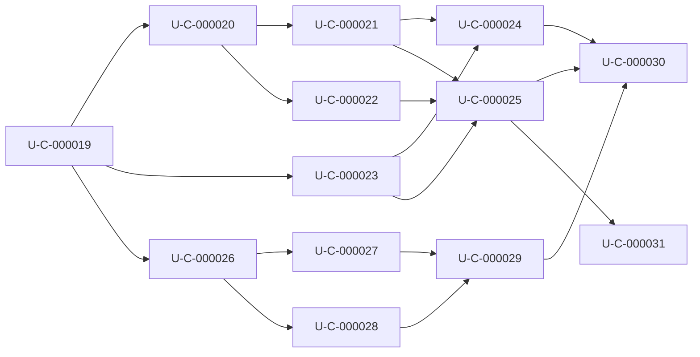

# Umsetzungsplan C-0.2: Kraft- und Momentenbilanz und Modellkatalog-Schnittstelle

## 1. Status und Geltungsbereich

**Stand: 26.10.2026.** Auf Nutzerauftrag erstellt. **Status: in Umsetzung;
U-C-000019 bis U-C-000031 nachgewiesen (CTest, GUI-Anbindung); Nutzerabnahme M4 offen.** Der Planauftrag ist keine Freigabe für Commit, Push, Tag
oder Release.

Dieser Plan ist der einzige maßgebliche Plan für den Versionsschritt
**C-0.2**. Er umfasst keine GUI-Implementierung; die zugehörige
GUI-Anbindung plant das GUI-Projekt eigenständig (Versionsschritt G-0.2).

Maßgeblich sind:

- [Spezifikation Kraft- und Momentenbilanz](../Spezifikationen/Spezifikation_Kraft_und_Momentenbilanz.md):
  A-C-00034 bis A-C-00041.
- [Spezifikation Modellkatalog-Schnittstelle](../Spezifikationen/Spezifikation_Modellkatalog_Schnittstelle.md):
  A-C-00042 bis A-C-00046.
- Entscheidungen: [Kraft_und_Momentenbilanz.json](../Spezifikationen/Entwurfspunkte/Kraft_und_Momentenbilanz.json)
  und [Modellkatalog_Schnittstelle.json](../Spezifikationen/Entwurfspunkte/Modellkatalog_Schnittstelle.json).
- Weiter gültig: A-C-00016, A-C-00017, A-C-00028, A-C-00031, A-C-00032;
  als Nachtrag A-C-00047 (Volllaufen offener Rümpfe)
  ([Hydrostatikkern](../Spezifikationen/Spezifikation_Hydrostatikkern.md)).

## 2. Arbeits- und Nachweisregeln

- Es gelten die Regeln aus Abschnitt 2 des
  [Umsetzungsplans Hydrostatikkern](Umsetzungsplan_Hydrostatikkern.md):
  Statusfolge offen → in Arbeit → implementiert → nachgewiesen → fachlich
  abgenommen; kein Statuswechsel ohne Beleg.
- Tests entstehen mit dem jeweiligen Baustein (CTest). Bestehende Tests
  (`hydrostatik_referenzen`, `simulation_gesamtlauf`, `modell_import`,
  `pose_transformations`, CLI-Tests) bleiben grün.
- Neue Fehler-IDs werden zuerst im Fehlerkatalog angelegt.
- `Dokumentationen/Schnittstelle_Core_GUI.md` beschreibt nur Implementiertes;
  geplante Felder sind getrennt gekennzeichnet (A-C-00028).
- Die Version-1-Felder des Ergebnisvertrags bleiben unverändert, damit die
  GUI G-0.1 weiter funktioniert.
- Laufzeit: Die Hydrostatikauswertung pro Schritt darf durch die
  Erweiterung nicht messbar langsamer werden; Vergleich mit
  `PerformanceOptimiert.json`.

## 3. Umsetzungsschritte

| ID | Kurztitel | Anforderungen | Voraussetzungen | Status |
|---|---|---|---|---|
| U-C-000019 | Vertrag V2 und Katalogschema festlegen | A-C-00041, A-C-00046 | – | nachgewiesen |
| U-C-000020 | Beitragsregister und Datenzustände | A-C-00034, A-C-00037 | U-C-000019 | nachgewiesen |
| U-C-000021 | Momente je Beitrag und Summen | A-C-00035, A-C-00036 | U-C-000020 | nachgewiesen |
| U-C-000022 | Bilanzstatus und Vollständigkeit | A-C-00038 | U-C-000020 | nachgewiesen |
| U-C-000023 | Gleichgewichtsangaben der Statik | A-C-00039 | U-C-000019 | nachgewiesen |
| U-C-000024 | Referenzfälle und Parität | A-C-00035, A-C-00036, A-C-00040 | U-C-000021, U-C-000023 | nachgewiesen |
| U-C-000025 | Serialisierung V2 und Referenzaufzeichnungen | A-C-00041 | U-C-000021, U-C-000022, U-C-000023 | nachgewiesen |
| U-C-000026 | Modellkatalog | A-C-00042, A-C-00043 | U-C-000019 | nachgewiesen |
| U-C-000027 | Details auf Abruf | A-C-00042, A-C-00044 | U-C-000026 | nachgewiesen |
| U-C-000028 | Fassungsprüfung und Lauf über Modell-ID | A-C-00045 | U-C-000026 | nachgewiesen |
| U-C-000029 | JSON-Antworten und Vertragstests Katalog | A-C-00046 | U-C-000027, U-C-000028 | nachgewiesen |
| U-C-000030 | Gesamtnachweis und GUI-Übergabe C-0.2 | A-C-00034 bis A-C-00046 | U-C-000024, U-C-000025, U-C-000029 | nachgewiesen |
| U-C-000031 | Nachtrag: Volllaufen offener Rümpfe | A-C-00047 | U-C-000025 | nachgewiesen |

### U-C-000019: Vertrag V2 und Katalogschema festlegen

**Anforderungen:** A-C-00041, A-C-00046. **Voraussetzungen:** keine.
**Status:** nachgewiesen.

- Feldliste für Vertragsversion 2 festlegen: `quelle`, `gruppe`, `rolle`,
  `punktart`, `zustand`, `fehler_id`, `moment_s_nm` je Beitrag; Summenobjekte
  mit Quellverweisen; `bilanzstatus`, `erwartete_beitraege`, `fehlende_beitraege`;
  Gleichgewichtsfelder der Statik.
- Katalogschema mit `katalogversion` und den Antworten von
  `modellkatalog`, `modellstruktur`, `darstellungsgeometrie`, `modelldiagnose`.
- Neue Fehler-IDs (z. B. ungültiger Beitrag, doppelte Modell-ID, Ordner nicht
  lesbar, veraltete Fassung, unbekannte Modell-ID) im Fehlerkatalog anlegen.
- Schema im Abschnitt „geplant“ der Schnittstellenbeschreibung eintragen.

**Ergebnis/Abnahme:** Schema dokumentiert, Fehlerkatalog-Build grün.

### U-C-000020: Beitragsregister und Datenzustände

**Anforderungen:** A-C-00034, A-C-00037. **Voraussetzungen:** U-C-000019.
**Status:** nachgewiesen.

- `Beitrag` (hydrostatik.hpp) um Quelle, Gruppe, Rolle, Punktart und Zustand
  erweitern; bestehende IDs unverändert.
- Auftrieb ohne Volumen als `null`, nicht endliche Werte als `ungueltig` mit
  Fehler-ID kennzeichnen.

**Ergebnis/Abnahme:** Test auf stabile, eindeutige IDs über Dynamikschritte
und auf jeden Zustandswert.

### U-C-000021: Momente je Beitrag und Summen

**Anforderungen:** A-C-00035, A-C-00036. **Voraussetzungen:** U-C-000020.
**Status:** nachgewiesen.

- Moment jedes Kraftbeitrags um S im Modellframe berechnen.
- Gruppen- und Gesamtsummen (ΣF, ΣM) im Modellframe mit Quellverweisen;
  die bisher nur intern im Weltframe geführte Gesamtkraft wird umgerechnet.
- Kein Beitrag doppelt; Gewicht genau einmal.

**Ergebnis/Abnahme:** Summentest; Laufzeitvergleich ohne messbare
Verschlechterung.

### U-C-000022: Bilanzstatus und Vollständigkeit

**Anforderungen:** A-C-00038. **Voraussetzungen:** U-C-000020.
**Status:** nachgewiesen.

- Erwarteten Quellenumfang aus Modell und Rechenmodus bestimmen.
- Bilanzstatus `vollstaendig`, `teilsumme`, `ungeklaert` mit Liste der Lücken.

**Ergebnis/Abnahme:** Referenzquader `vollstaendig`; Test mit erzwungen
fehlendem Beitrag `teilsumme`.

### U-C-000023: Gleichgewichtsangaben der Statik

**Anforderungen:** A-C-00039. **Voraussetzungen:** U-C-000019.
**Status:** nachgewiesen.

- `SolverErgebnis` um verwendete Toleranzen, Residuen und geprüfte
  Freiheitsgrade erweitern (Iterationen bestehen bereits).
- Dynamische Zustände ohne Gleichgewichtsaussage.

**Ergebnis/Abnahme:** Konvergierter und nicht konvergierter Testfall.

### U-C-000024: Referenzfälle und Parität

**Anforderungen:** A-C-00035, A-C-00036, A-C-00040.
**Voraussetzungen:** U-C-000021, U-C-000023. **Status:** nachgewiesen.

- Algebraische Referenzfälle aus Abschnitt 3 der Spezifikation als CTest
  (`rtol = 1e-10`, `atol = 1e-9`).
- Paritätstest: Beitragssumme gegen die vom Statiksolver und vom
  Dynamikschritt verwendete Bilanz desselben Zustands.

**Ergebnis/Abnahme:** Alle Referenzfälle und Paritätstests grün.

### U-C-000025: Serialisierung V2 und Referenzaufzeichnungen

**Anforderungen:** A-C-00041. **Voraussetzungen:** U-C-000021,
U-C-000022, U-C-000023. **Status:** nachgewiesen.

- `zustand_json` und CLI-Aufzeichnung auf `vertragsversion: "2"` erweitern;
  Version-1-Felder unverändert.
- Beispiele unter `Dokumentationen/Beispiele_Core_GUI` neu erzeugen.
- Schnittstellenbeschreibung auf den implementierten Stand bringen.

**Ergebnis/Abnahme:** Vertragstests für Statik und Dynamik; Kompatibilitätstest
mit einem Version-1-Leser.

### U-C-000026: Modellkatalog

**Anforderungen:** A-C-00042, A-C-00043. **Voraussetzungen:** U-C-000019.
**Status:** nachgewiesen.

- `modellkatalog(ordner)` mit Suchregel (Ordner und direkte Unterordner),
  Katalogobjekt ohne globalen Zustand, stabiler Reihenfolge.
- Status `verwendbar`/`fehlerhaft` über die bestehende Modellprüfung;
  doppelte Modell-IDs und nicht lesbarer Ordner als Fehler.

**Ergebnis/Abnahme:** Test mit Beispielordner, fehlerhaftem Modell und
ID-Duplikat.

### U-C-000027: Details auf Abruf

**Anforderungen:** A-C-00042, A-C-00044. **Voraussetzungen:** U-C-000026.
**Status:** nachgewiesen.

- `modellstruktur`, `darstellungsgeometrie`, `modelldiagnose`.
- OBJ-Lesen der Darstellungsnetze im Core; Ersatz durch Volumennetz als
  `volumen_ersatz` gekennzeichnet; Geometrie fehlerhafter Modelle, soweit
  lesbar.
- Keine internen Rechendaten und keine Pfade in den Antworten.

**Ergebnis/Abnahme:** Eckpunkt- und Dreieckszahlen der Referenzmodelle
stimmen mit der GUI G-0.1 überein.

### U-C-000028: Fassungsprüfung und Lauf über Modell-ID

**Anforderungen:** A-C-00045. **Voraussetzungen:** U-C-000026.
**Status:** nachgewiesen.

- Detail- und Laufanfragen mit erwarteter `modell_fassung`; geänderte
  Datei führt zur Fehler-ID.
- Prüfung, Statik und Dynamik über Katalogobjekt und Modell-ID startbar.

**Ergebnis/Abnahme:** Test mit nachträglich geänderter Modelldatei.

### U-C-000029: JSON-Antworten und Vertragstests Katalog

**Anforderungen:** A-C-00046. **Voraussetzungen:** U-C-000027,
U-C-000028. **Status:** nachgewiesen.

- JSON-Serialisierung aller Katalogantworten mit `katalogversion`.
- Vertragstests ohne GUI; Beispiele und Schnittstellenbeschreibung
  aktualisieren.

**Ergebnis/Abnahme:** Vertragstests grün; Doku, Beispiele und
Fehlerkatalog stimmen überein.

### U-C-000030: Gesamtnachweis und GUI-Übergabe C-0.2

**Anforderungen:** A-C-00034 bis A-C-00046. **Voraussetzungen:**
U-C-000024, U-C-000025, U-C-000029. **Status:** nachgewiesen.

- Alle CTests, Laufzeitvergleich, Abgleich Anforderungen ↔ Nachweise.
- `GUI_Uebergabe.md` um die neuen Schnittstellen ergänzen.

**Ergebnis/Abnahme:** Rückverfolgbarkeitsmatrix vollständig belegt.

**Nachweis GUI-Übergabe (26.10.2026):** Die GUI (G-0.2) liest Aufzeichnung
V1/V2, `modellkatalog` und `darstellungsgeometrie` ausschließlich über den
Core. Im GUI-Build sind 17/17 CTests grün (13 Core plus
`gui_core_integration`, `gui_model_catalog`, `gui_display_mesh`,
`gui_force_display`). Smoke-Test mit den Referenzmodellen: 11 Katalogeinträge,
davon 8 verwendbar; Bilanzkarte V2 „vollstaendig“; Live-Dynamik Quader
10 s mit 13,56 ms Core-Rechenzeit. Die fachliche Nutzerabnahme (M4) steht
noch aus.

### U-C-000031: Nachtrag: Volllaufen offener Rümpfe

**Anforderungen:** A-C-00047 (Nachtrag auf Nutzerauftrag bei der
Optimist-Reparatur). **Voraussetzungen:** U-C-000025. **Status:** nachgewiesen.

- Modellimport: Bordrand (Kanten mit nur einer Fläche) offener
  Schalen-Massennetze in `Element::flutrand_m`; nur mit Volumen.
- `flutung()`, `hydrostatik(..., geflutet)`, `Zustand::geflutet`;
  Statik mit Wiederholung nach neuer Flutung, Dynamik mit Prüfung an
  Start- und Endpose jedes Schritts.
- Ergebnisvertrag V2 additiv: `geflutete_elemente`, `elementvolumina[].geflutet`.
- Start eines Laufs von einem übergebenen Zustand (`Laufoptionen::start`)
  übernimmt die Flutung; die GUI nutzt das beim Moduswechsel (G-0.2).

**Ergebnis/Abnahme:** Tests `modell_import` (Bordrand nur bei offener
Schale mit Volumen), `hydrostatik_referenzen` (trocken, geflutet und
schwimmend auf Tank, Überlast mit Diagnose, dauerhafte Flutung in der
Dynamik, Vollkörper flutet nie), `kraft_momentenbilanz` (neue JSON-Felder).

**Nachweis (27.10.2026):** 17/17 CTests grün. CLI mit Optimist (Stand vor
der Anhebung): Statik konvergiert trocken bei z = 1,354 m (Verdrängung
0,098 m³). Dynamik ab Initialpose z = 0 flutet den Rumpf sofort; das Boot
sinkt (nach 3 s z = −43,7 m), `geflutete_elemente: ["Rumpf"]`.

**Nachtrag (27.10.2026, Optimist angehoben):** Auf Nutzerauftrag wurden alle
Optimist-Netze und die Besatzung um +1,354 m in z verschoben. Statik
konvergiert jetzt bei z ≈ 0,0002 m; Dynamik 20 s ab Initialpose bleibt
zwischen z = −0,006 und +0,006 m, nichts geflutet. Der Flutungspfad bleibt
durch die CTests (`hydrostatik`) nachgewiesen.

## 4. Reihenfolge und Meilensteine

| Meilenstein | Eintritt | Abnahme |
|---|---|---|
| M1 Vertrag festgelegt | Spezifikationen final | U-C-000019 abgeschlossen, Schema dokumentiert |
| M2 Kraftbilanz V2 | M1 | U-C-000020 bis U-C-000025 nachgewiesen; GUI kann V2-Teile beginnen |
| M3 Modellkatalog | M1 | U-C-000026 bis U-C-000029 nachgewiesen; GUI kann Katalog-Anbindung beginnen |
| M4 Abschluss C-0.2 | M2, M3 | U-C-000030; Nutzerabnahme |

Die Stränge M2 und M3 sind unabhängig und können parallel bearbeitet werden.

## 5. Rückverfolgbarkeit

| Anforderung | Umsetzungsschritte | Nachweis | Status |
|---|---|---|---|
| A-C-00034 | U-C-000020, U-C-000030 | ID-Stabilitätstest | nachgewiesen |
| A-C-00035 | U-C-000021, U-C-000024 | Referenzfälle | nachgewiesen |
| A-C-00036 | U-C-000021, U-C-000024 | Summentest | nachgewiesen |
| A-C-00037 | U-C-000020 | Zustandstests | nachgewiesen |
| A-C-00038 | U-C-000022 | Bilanzstatus-Tests | nachgewiesen |
| A-C-00039 | U-C-000023 | Statiktests | nachgewiesen |
| A-C-00040 | U-C-000024 | Paritätstests | nachgewiesen |
| A-C-00041 | U-C-000019, U-C-000025 | Vertragstests, Beispiele | nachgewiesen |
| A-C-00042 | U-C-000026, U-C-000027 | Feldprüfung Vertragstest | nachgewiesen |
| A-C-00043 | U-C-000026 | Katalogtests | nachgewiesen |
| A-C-00044 | U-C-000027 | Geometrievergleich | nachgewiesen |
| A-C-00045 | U-C-000028 | Fassungstest | nachgewiesen |
| A-C-00046 | U-C-000019, U-C-000029 | Vertragstests Katalog | nachgewiesen |
| A-C-00047 | U-C-000031 | Flutungstests, Optimist-CLI | nachgewiesen |

## 6. Offene Punkte

- Keine offenen fachlichen Entscheidungen; alle Entwurfspunkte sind entschieden.
- Laufzeitgrenzen über „keine messbare Verschlechterung“ hinaus legt die
  Nutzerin nach der Messung fest (IDEE-C-00009 bleibt offen).

## 7. Tatsächliche Ergebnisse

- U-C-000019 bis U-C-000030: siehe Nachweise in den Abschnitten oben.
- U-C-000031 (Nachtrag 27.10.2026): Volllaufen offener Rümpfe umgesetzt;
  der reparierte Optimist (offene GFK-Schale 5 mm, Spieren 1,5 mm) schwimmt
  statisch trocken und nach der Anhebung (+1,354 m) auch ab Initialpose.
  Teilflutung, Lecks und Lenzen sind nicht umgesetzt.
