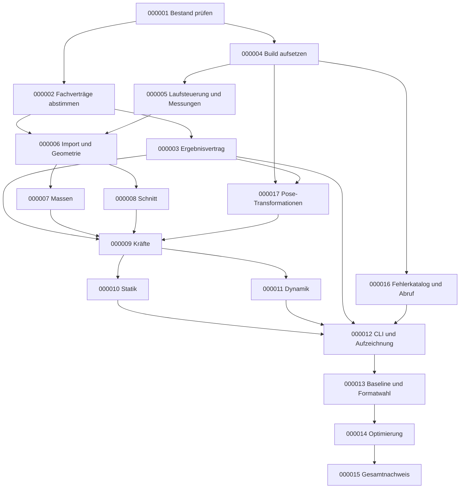

# Umsetzungsplan: erste Core-Ausbaustufe Hydrostatikkern

## 1. Status und Geltungsbereich

**Stand: 26.10.2026.** Auf Nutzerauftrag erstellter Umsetzungsplan.
Bestandsaufnahme und ein vorgezogener unabhängiger Buildtest begonnen.
Modellimport, Masseneigenschaften, Schnitt, gemeinsame Kräfte, Statik,
Dynamik, Aufzeichnung und Zeitmessungen sind implementiert und technisch
getestet. Eine Baseline und ein Optimierungsvergleich liegen vor.
Keine vorbehaltlose fachliche Gesamtabnahme; bekannte Grenzen und
offene Abnahmekriterien stehen in Abschnitt 7.
Der Planauftrag ist keine Freigabe für Commit, Push, Tag oder Release.

Dieser Plan ist der einzige maßgebliche Plan für den Versionsschritt
**„Erste Core-Ausbaustufe: statische und dynamische Hydrostatik“**.
Der erste technische Sicherungsstand ist **C-0.1** (Nutzerauftrag
26.10.2026). Dieser Tag dokumentiert Implementierung und Testnachweise,
nicht die noch offene fachliche Gesamtabnahme.
Der Plan umfasst keine GUI-Implementierung.

Maßgeblich sind:

- [Hydrostatikkern-Spezifikation](../Spezifikationen/Spezifikation_Hydrostatikkern.md):
  A-C-00004 bis A-C-00029 sowie A-C-00031 und A-C-00032.
- [Modellbeschreibungs-Spezifikation](../Spezifikationen/Spezifikation_Modellbeschreibung.md):
  A-C-00001 bis A-C-00003 und A-C-00030.
- [Offene Hydrostatikentscheidungen](../Spezifikationen/Entwurfspunkte/Hydrostatikkern.json)
  und [Modellformatentwürfe](../Spezifikationen/Entwurfspunkte/Modellformat.json).
  Entwurfspunkte sind keine zusätzlichen freigegebenen Anforderungen.

## 2. Arbeits- und Nachweisregeln

- Der tatsächliche Status steht am jeweiligen Schritt.
  Abhängigkeiten sind tatsächliche Voraussetzungen, nicht bloß die
  Reihenfolge der Kennungen.
- Statusfolge: offen → in Arbeit → implementiert → nachgewiesen →
  fachlich abgenommen. Ein Hindernis wird als **blockiert** mit Ursache
  festgehalten; kein Statuswechsel ohne passenden Beleg.
- Vor fachlichen Festlegungen aus offenen Entwurfspunkten ist eine
  Nutzerentscheidung erforderlich. Diese wird in der maßgeblichen
  Spezifikation und der Entwurfspunkteliste nachgeführt.
- Funktionstests entstehen mit dem jeweiligen Rechenbaustein.
  Der abschließende Testschritt ersetzt keine begleitenden Tests.
- Im Plan werden tatsächliche Testkommandos, Ergebnisse und Belegpfade
  fortlaufend ergänzt. Fehlende Belege werden nicht durch geplante
  Dateinamen oder historische Testerfolge ersetzt.
- Unterstützende Inventare und Messergebnisse dürfen separat liegen;
  sie sind keine weiteren Spezifikationen oder Umsetzungspläne.
- CLI und Bibliothek dürfen bereits prototypisch geprüft werden.
  Fachliche Abnahmen bleiben bis zur Freigabe der einschlägigen
  Toleranzen, Verträge und Verfahren offen.

## 3. Umsetzungsschritte

### U-C-000001: Altcode und Testbestand bewerten

**Anforderungen:** A-C-00004, A-C-00005, A-C-00006, A-C-00018.
**Voraussetzungen:** Keine. **Status:** Quellen bewertet und Testinventar zugeordnet;
keine behauptete Altcode-Parität.

- Relevante Quellen aus SegelPhysik3 und deren Abhängigkeiten tatsächlich
  lesen: Import, Masseneigenschaften, Ebenenschnitt, Hydrostatik,
  Statik, Dynamik, Build und zugehörige Tests.
- Je Funktionalität Übernahme, Anpassung oder Ersatz begründet erfassen.
  GUI-, Python- und fremde Physikabhängigkeiten ausdrücklich kennzeichnen.
- Testinventar mit Zweck, Herkunft, neuem Vertrag und Entscheidung
  anlegen; unabhängige Referenzen von Altcode-Parität unterscheiden.

**Ergebnis/Abnahme:** Prüfbares Übernahme- und Testinventar unter
Dokumentationen; offene oder noch ungelesene Bereiche sichtbar.
**Tatsächliche Nachweise:**
[Vorläufige Bestandsaufnahme](../Dokumentationen/Bestandsaufnahme_Hydrostatikkern.md).
Die relevanten C++-Rechenkerne sind bewertet.
Das [Testinventar](../Dokumentationen/Testinventar_Hydrostatikkern.json)
ordnet 107 Module mit 939 Testfunktionen ihren Themen, neuen
Prüfprogrammen oder begründeter Nichtübernahme zu.
Der alte Python-/Manifestimport wird wegen des neuen Importvertrags
ersetzt, nicht ungeprüft übernommen. Die Zuordnung ist kein
zeilenweiser semantischer Gleichwertigkeitsnachweis.

### U-C-000002: Fachliche und numerische Verträge abstimmen

**Anforderungen:** A-C-00001, A-C-00002, A-C-00003, A-C-00007,
A-C-00008, A-C-00009, A-C-00010, A-C-00011, A-C-00013,
A-C-00014, A-C-00019, A-C-00029.
**Voraussetzungen:** U-C-000001. **Status:** teilweise abgestimmt;
technische Arbeitsentscheidungen dokumentiert, fachliche Gesamtbudgets offen.

- Mit dem Nutzer den minimal benötigten Modellimport im bestehenden
  Thema Modellbeschreibung finalisieren; keine Beispieldatei ungeprüft
  zur verbindlichen Eingabesprache erklären.
- Schalenflächen, Volumenüberschneidungen und Umfang der Meshprüfung
  klären, ebenso statische Residuen und dynamisches Integrationsverfahren.
- Pro Größe Wertebereich, fachliche absolute/relative Toleranz und
  numerisches Fehlerbudget von höchstens einem Zehntel festlegen.
  Geometrie-, Integrations-, Rundungs- und Anzeigeeffekte trennen.
- Grenzfälle und Referenzfälle definieren, einschließlich
  Zentimeter-/Kilogrammorientierung und sinnvoller Volumengenauigkeit.
- Zahlenformat noch nicht pauschal festschreiben: Auswahl durch
  Genauigkeitsnachweise und vergleichbare Messungen vorbereiten.

**Ergebnis/Abnahme:** Nutzerentscheidungen in den zuständigen
Spezifikationen dokumentiert; einschlägige Entwurfspunkte aktualisiert.
Neue Modellanforderungen erhalten bei Freigabe neue fortlaufende IDs
und werden vor Implementierung in diesen Plan aufgenommen.
**Tatsächliche Nachweise:** Teilentscheidungen dokumentiert:
Beispielaufbau als Importgrundlage (A-C-00030), Ablehnung fehlerhafter
Modelle (A-C-00031) und überlappender Volumina (A-C-00010).
Genauigkeiten und konkrete Prüfverfahren stehen weiterhin aus.

### U-C-000003: Ergebnisvertrag und GUI-Dokumentation konkretisieren

**Anforderungen:** A-C-00012, A-C-00014, A-C-00016, A-C-00017,
A-C-00028, A-C-00029.
**Voraussetzungen:** U-C-000002. **Status:** implementierter Vertrag dokumentiert;
Live-Transport bleibt nachgelagert.

- Feldschema, Vertragsversion, Modellbindung, Status und optionale Werte
  konkretisieren; Quaternionreihenfolge, Modell-nach-Welt-Rotation,
  Geschwindigkeitsframes und Momentenbezugspunkte abstimmen.
- Eine Modellpose und die typisierte Vektorliste als zusammengehörigen
  Zustand mit Simulationszeit und dynamischer Schrittnummer definieren.
- Erstes Aufzeichnungsformat abstimmen. Transportfragen getrennt halten:
  Dieser Plan implementiert keinen ungefragt gewählten WebSocket-Dienst.
- Unter Dokumentationen die zentrale
  **Schnittstellenbeschreibung / Ergebnisvertrag Core → GUI** beginnen.
  Vorgesehene und tatsächlich implementierte Felder eindeutig unterscheiden.

**Ergebnis/Abnahme:** Technischer Vertrag und freigegebene Konventionen
sind ohne Solverquellcode verständlich. Beispielentwürfe werden noch
nicht als implementierte oder testvalidierte Ergebnisse ausgegeben.
**Tatsächliche Nachweise:**
[Schnittstellenbeschreibung](../Dokumentationen/Schnittstelle_Core_GUI.md)
mit implementiertem Fehlerkatalogabruf und tatsächlichen Ergebnisdaten.
Quaternionreihenfolge xyzw wurde nach Erklärung vom Nutzer bestätigt;
Aufzeichnungsformate nach Geschwindigkeitsvergleich implementiert:
JSONL als Bibliotheksstandard, JSON-Array ebenfalls verfügbar.

### U-C-000004: C++-Bibliothek, CLI und headless Testbuild aufsetzen

**Anforderungen:** A-C-00004, A-C-00005, A-C-00020, A-C-00022.
**Voraussetzungen:** U-C-000001. **Status:** implementiert und technisch getestet.
Der unabhängig prüfbare Build wurde vorgezogen; Quellenbewertung
und Testzuordnung aus U-C-000001 liegen inzwischen vor.

- CMake-Build für eigenständige Bibliothek, dünne CLI und Tests anlegen.
  Produktive Ausführung ohne Python und GUI sicherstellen.
- Debug-/Release- und Testinstrumentierungsvarianten klar trennen.
  Vorhandenes geeignetes Testwerkzeug nutzen; neue Abhängigkeiten begründen.
- Einen kleinen Build-/CLI-Smoke-Test einführen; noch keine Fachrechnung
  als implementiert ausgeben.

**Ergebnis/Abnahme:** Bibliothek, CLI und Testtreiber bauen und laufen
headless; produktiver Build benötigt keine Python-/GUI-Anbindung.
**Tatsächliche Nachweise:**
[Build und Tests](../Dokumentationen/Bestandsaufnahme_Hydrostatikkern.md):
MSVC-Release-Builds mit/ohne Tests sowie vorbereiteter Testinstrumentierung.
Standard- und Testinstrumentierungsbuild aktuell jeweils 11/11 CTest-Tests bestanden;
unzulässige Optionskombination ausdrücklich abgelehnt.
Python und GUI werden nicht benötigt. Echte Timer und deren
Laufzeitaktivierung sind inzwischen in U-C-000005 implementiert.

### U-C-000016: Fehlerkatalog und dokumentierten Abfrageweg bereitstellen

**Anforderungen:** A-C-00028, A-C-00031, A-C-00032.
**Voraussetzungen:** Der unabhängige Buildteil von U-C-000004.
**Status:** implementiert und technisch nachgewiesen; fachliche Gesamtabnahme offen.

- Dauerhafte Fehler-IDs, Pass-/Fail-Kriterien und Korrekturhinweise
  in genau einem JSON-Katalog führen; geplante Prüfungen kennzeichnen.
- Anfrage „gib mir Fehlerdoku“ im Schnittstellenvertrag beschreiben.
  Bis zum Live-Transport über Bibliothek und CLI-Schalter `--fehlerdoku`
  bereitstellen, ohne Modellladevoraussetzung.
- JSON beim Build prüfen und einbetten; aktuelle CLI-Fehler gegen den
  Katalog testen. Modellfehlerprüfungen selbst gehören zu U-C-000006.

**Ergebnis/Abnahme:** Katalogabruf stimmt mit der maßgeblichen JSON-Datei
überein. Tatsächliche Fehler-IDs sind als implementiert dokumentiert;
geplante Modellprüfungen werden nicht als implementiert ausgegeben.
**Tatsächliche Nachweise:** Bibliotheks-/CLI-Code und
[Schnittstellenbeschreibung](../Dokumentationen/Schnittstelle_Core_GUI.md)
vorhanden. Standard- und Testinstrumentierungsbuild jeweils 11/11 Tests
bestanden; Produktionsabruf mit UTF-8-JSON aus anderem Arbeitsverzeichnis
geprüft. Der Katalog enthält 18 Einträge mit implementierten Prüfungen;
die dokumentierten Geometriegrenzen bleiben zu beachten.

### U-C-000017: Pose-Transformationen für den Ergebnisvertrag implementieren

**Anforderungen:** A-C-00001, A-C-00002, A-C-00003, A-C-00016, A-C-00029.
**Voraussetzungen:** Unabhängiger Buildteil von U-C-000004 und
Nutzerentscheidung xyzw aus U-C-000003.
**Status:** implementiert und technisch nachgewiesen; vollständige
physikalische Genauigkeitsabnahme offen.

- Feste Modellposition und normiertes Quaternion xyzw abbilden.
- Punkte mit Rotation/Translation und Vektoren nur mit Rotation in
  beide Richtungen transformieren; Referenzlage rechtshändig erhalten.
- Nicht endliche Eingaben und Überläufe mit katalogisierten Fehlern
  ablehnen; sehr große/kleine gültige Quaternionen stabil normieren.

**Ergebnis/Abnahme:** Unabhängige Achsenrotations- und Inversentests
sowie Grenzfälle bestehen. Das vorläufige Zahlenformat `double` ist
noch keine abschließende Performance-/Genauigkeitsentscheidung.
**Tatsächliche Nachweise:** `pose_transformations` in beiden Release-
Testbuilds bestanden; Header und Semantik in der
[Schnittstellenbeschreibung](../Dokumentationen/Schnittstelle_Core_GUI.md).

### U-C-000005: Laufsteuerung und Messinfrastruktur einführen

**Anforderungen:** A-C-00015, A-C-00020, A-C-00021, A-C-00022,
A-C-00023, A-C-00024.
**Voraussetzungen:** U-C-000004. **Status:** implementiert und technisch getestet.

- Laufstatus und kontrollierten Abbruch mit einem monotonen Gesamttimer
  aufsetzen: Vorbereitung bis abgeschlossene Ergebnisaufzeichnung.
- Für Fehler und Abbruch denselben verlässlichen Abschlussweg testen.
  Ausgabe des Laufzeitberichts von der gemessenen Aufzeichnung abgrenzen.
- Detailtimer technisch aus dem Normalbetrieb entfernen und in
  Testbuilds zusätzlich ausdrücklich aktivieren.
- Messregister unter Dokumentationen anlegen, sobald erste Messpunkte
  implementiert sind. Nur diese eintragen; spätere Timer jeweils mitführen.

**Ergebnis/Abnahme:** Erfolgs-/Fehler-/Abbruchtests sowie Tests für
Normal-/Instrumentierungsbetrieb bestehen. Register und implementierte
Messpunkte stimmen überein.
**Tatsächliche Nachweise:** `simulation_gesamtlauf` und
`hydrostatik_referenzen`; [Messregister](../Dokumentationen/Zeitmessungen.md).
Normalbetrieb ohne Detailmessung, Instrumentierungsbetrieb mit
expliziter Aktivierung und allen sieben Messpunkten geprüft.

### U-C-000006: Modellimport und Geometrievorbereitung implementieren

**Anforderungen:** A-C-00001, A-C-00002, A-C-00003, A-C-00007,
A-C-00008, A-C-00010, A-C-00023, A-C-00024, A-C-00025, A-C-00029.
Zusätzlich: A-C-00030, A-C-00031.
**Voraussetzungen:** U-C-000002, U-C-000005. **Status:** implementiert
und getestet, mit ausdrücklich konservativer Überlappungsprüfung.

- Freigegebenes Modellformat mit eindeutigen IDs und zweckgetrennten
  Dateien importieren; SI-Konventionen und gegebenenfalls ausdrücklich
  erlaubte Eingabekonvertierungen anwenden.
- Pflichtmasse und optionales Volumen prüfen. Kein Rückgriff auf GUI-
  oder Massengeometrie zur Erzeugung fehlender Verdrängung.
- Gültigkeit von Netzen und freigegebene Überlappungsstrategie umsetzen.
  Feste Modellursprünge nicht automatisch verschieben.
- Konstante Geometriedaten und wiederverwendbare Arbeitsbereiche
  vorbereiten; Modellvorbereitung im Testbetrieb messen.

**Ergebnis/Abnahme:** Positive/negative Import- und Meshprüfungen
bestehen. Dekorative Elemente bleiben physikfrei; fehlendes Volumen
erzeugt exakt null Auftrieb. Grenzen der Prüfung sind dokumentiert.
**Tatsächliche Nachweise:** `modell_import`, `simulation_gesamtlauf`
und CLI-Modellprüfung. Grenzen einschließlich AABB-Fehlablehnungen:
[Schnittstellenbeschreibung](../Dokumentationen/Schnittstelle_Core_GUI.md).

### U-C-000007: Masseneigenschaften und Schwerpunktbezug implementieren

**Anforderungen:** A-C-00003, A-C-00008, A-C-00009, A-C-00019,
A-C-00023, A-C-00024, A-C-00025, A-C-00029.
**Voraussetzungen:** U-C-000006. **Status:** implementiert und mit Referenzen getestet.

- Punktmassen, homogene Vollkörper und freigegebene Schalenintegration
  mit Schwerpunkt und Trägheit implementieren.
- Gesamtwerte einschließlich Steiner-Anteilen vorbereiten; feste
  Konstruktion von Gesamtschwerpunkt und dynamischem Bezug trennen.
- Untaugliche Gesamtträgheiten ohne versteckte Regularisierung melden.
  Die gesamte Massenbestimmung als Testmesspunkt registrieren.

**Ergebnis/Abnahme:** Analytische Einzelkörper, Schalen und
zusammengesetzte Punktmassen erfüllen die abgestimmten Fehlerbudgets.
Beladungsänderung verschiebt nicht den Konstruktionsursprung.
**Tatsächliche Nachweise:** `modell_import`: Punkt-/Steiner-, Würfel-,
Tetraeder- und Dreiecksflächenreferenzen einschließlich Verschiebung
und Unterteilung. Schalenflächenkonvention und Grenzen sind dokumentiert.

### U-C-000008: Ebenenschnitt und Volumenmomente implementieren

**Anforderungen:** A-C-00001, A-C-00002, A-C-00010, A-C-00011,
A-C-00019, A-C-00023, A-C-00024, A-C-00025, A-C-00029.
**Voraussetzungen:** U-C-000006. **Status:** implementiert und mit Referenzen getestet.

- Wasserebene in den Modellbezug transformieren; eingetauchtes Volumen
  und erstes Moment aus dem vorbereiteten diskreten Netz bestimmen.
- Trocken-/Vollnassfälle und wiederverwendbare Schnittpuffer einführen.
  Numerische Grenzfallregeln aus U-C-000002 anwenden.
- Schnitt als Gesamtoperation testinstrumentieren; keine Timer je Dreieck.

**Ergebnis/Abnahme:** Analytische Schnitte, Ecke/Kante/Fläche,
Transformationen, Trocken-/Vollnass-Schnellpfade und kleine Restvolumina
sind geprüft; Fehlerbudget und Geometrieapproximation getrennt belegt.
**Tatsächliche Nachweise:** `hydrostatik_referenzen`: trockene,
teilweise und volle Quader, Grenzflächen, Rotationen und große
Modellkoordinaten. Keine ungeprüfte numerische Nullvolumenschwelle.

### U-C-000009: Gemeinsame Kraft- und Momentenauswertung implementieren

**Anforderungen:** A-C-00004, A-C-00008, A-C-00011, A-C-00012,
A-C-00016, A-C-00019, A-C-00023, A-C-00024, A-C-00029.
**Voraussetzungen:** U-C-000003, U-C-000007, U-C-000008, U-C-000017.
**Status:** implementiert und mit Referenzen getestet.

- Gewicht und Auftrieb mit Elementzuordnung und konsistenten Momenten
  bestimmen; Gesamtsummen ohne Doppelzählung bilden.
- Nullvolumen ohne erfundenen Auftriebsschwerpunkt behandeln.
- Beiträge in die vereinbarte Vektordarstellung überführen und
  vollständige Hydrostatikauswertung als Testmesspunkt registrieren.

**Ergebnis/Abnahme:** Kräfte, Ansatzpunkte und Momente stimmen mit
unabhängigen Referenzen überein. Kombinierte Rotation/Translation,
Nullvektor und Momentenbezug sind geprüft.
**Tatsächliche Nachweise:** `hydrostatik_referenzen` und
`simulation_gesamtlauf`; gemeinsame Funktion für beide Solver,
Elementgewichte/-auftriebe und Momentenbezug im GUI-Vertrag.

### U-C-000010: Statischen Gleichgewichtssolver implementieren

**Anforderungen:** A-C-00004, A-C-00006, A-C-00012, A-C-00013,
A-C-00015, A-C-00019, A-C-00021, A-C-00023, A-C-00024, A-C-00029.
**Voraussetzungen:** U-C-000009. **Status:** implementiert und mit Referenzen getestet.

- Z-Lage, Krängung und Trimm bei festem X/Y/Kurs lösen.
- Kraft- und Momentenresiduen getrennt prüfen; Nichtkonvergenz,
  nachgewiesene Unlösbarkeit und Abbruch unterscheidbar zurückgeben.
- Gesamten Solver testinstrumentieren und in Laufsteuerung einbinden.

**Ergebnis/Abnahme:** Symmetrische und asymmetrisch beladene Fälle,
Überlast, ungünstige Startlagen und Abbruch sind geprüft. Erfolg
setzt die vereinbarten Residuen voraus, nicht nur ein Iterationsende.
**Tatsächliche Nachweise:** `hydrostatik_referenzen`: symmetrischer
und asymmetrisch beladener Körper, trockener Start, Überlast und Abbruch.
Alle acht einfachen Beispielmodelle meldeten über die CLI Konvergenz.

### U-C-000011: Dynamischen Starrkörpersolver implementieren

**Anforderungen:** A-C-00004, A-C-00006, A-C-00009, A-C-00012,
A-C-00014, A-C-00015, A-C-00019, A-C-00021, A-C-00023,
A-C-00024, A-C-00029.
**Voraussetzungen:** U-C-000009. **Status:** implementiert und mit Referenzen getestet.

- Translation und Quaternionrotation mit abgestimmtem Integrator
  und lageaktueller gemeinsamer Kraftauswertung integrieren.
- Simulationszeit von Laufzeit und Darstellung entkoppeln.
  Keine versteckte Dämpfung oder ausgelassenen Zeitschritte.
- Vollständigen Zeitschritt als Testmesspunkt registrieren.

**Ergebnis/Abnahme:** Freier Fall ohne Volumen, ruhendes Gleichgewicht,
ausgelenkte Bewegung und Schrittweitenkonvergenz sind geprüft.
Abbruch, ungeeignete Trägheit und Wiederholbarkeit sind nachgewiesen.
**Tatsächliche Nachweise:** Freier Fall, Hauptachsenrotation,
ungültige Trägheit und Schrittweitenkonvergenz in
`hydrostatik_referenzen`; vollständiger CLI-Lauf separat geprüft.

### U-C-000012: Aufzeichnung und vollständige CLI-Läufe integrieren

**Anforderungen:** A-C-00005, A-C-00015, A-C-00016, A-C-00017,
A-C-00020, A-C-00021, A-C-00023, A-C-00024, A-C-00028, A-C-00029.
**Voraussetzungen:** U-C-000003, U-C-000010, U-C-000011, U-C-000016.
**Status:** implementiert und technisch getestet.

- Modellladen bis Ergebnisaufzeichnung für beide Laufarten verdrahten.
  Vollständige Zustände mit Pose/Vektoren, Zeit, Identität und Status
  ausgeben; unnötige Serialisierung interner Schritte vermeiden.
- Ergebnisaufzeichnung testinstrumentieren; Gesamtlaufzeitgrenze mit
  echtem Dateiabschluss, Fehler und Abbruch prüfen.
- GUI-Schnittstellenbeschreibung auf implementierten Stand bringen
  und statische/dynamische Referenzaufzeichnungen erzeugen.
- Dokumentationsbeispiele gegen denselben Vertrag wie reale Ergebnisse
  testen. Noch nicht vorhandenen Live-Transport ausdrücklich ausweisen.

**Ergebnis/Abnahme:** Beide Laufarten sind headless über CLI ausführbar.
Aufzeichnungen und Dokumentation reichen zur Interpretation ohne
Solvercode; auch Nullvolumen, Nichtkonvergenz und Abbruch sind abgedeckt.
**Tatsächliche Nachweise:** `simulation_gesamtlauf`, unabhängige
JSON-Prüfung und [echte Referenzaufzeichnungen](../Dokumentationen/Beispiele_Core_GUI).
Bestehende Dateien werden nicht überschrieben.

### U-C-000013: Performancebaseline und Zahlenformat vergleichen

**Anforderungen:** A-C-00019, A-C-00020, A-C-00022, A-C-00025,
A-C-00026, A-C-00029.
**Voraussetzungen:** U-C-000012. **Status:** Baseline und Vergleich
vorhanden; allgemeine Zahlenformat-/Performanceabnahme offen.

- Kleine analytische, mittlere zusammengesetzte und große Meshfälle
  mit statischen und dynamischen Gesamtläufen festlegen.
- Referenzhardware, Release-Build, Compiler, Threadzahl, Genauigkeit,
  Ausgabeumfang, Aufwärmung und Wiederholungen dokumentieren.
- Sinnvolle Zahlenformatkandidaten in vergleichbaren Rechenpfaden
  prüfen; kein vollumfängliches Mehrformat-Framework allein für den
  Vergleich bauen. Instabile/ungenügend genaue Kandidaten ausschließen.
- Median, Streuung, Gesamtdauer, Auswertungen/s und Simulations-/Laufzeit
  erheben. Detailinstrumentierte Messung vom Normalbetrieb unterscheiden.
- Mit dem Nutzer quantitative Ziele und zulässige Regressionen
  auf Grundlage der Baseline festlegen.

**Ergebnis/Abnahme:** Reproduzierbare Baseline, Faktor-10-Nachweise und
begründete Zahlenformatwahl liegen vor. Performanceabnahme erst nach
ausdrücklicher Festlegung der Zielgrenzen.
**Tatsächliche Nachweise:**
[Baseline](../Dokumentationen/Performancebaseline.json) und
[Vergleich](../Dokumentationen/PerformanceOptimiert.json), jeweils
kleiner, zusammengesetzter und großer Fall einschließlich Gesamtläufen.
`double` bleibt nach Genauigkeitsprobe ohne belegten float-Vorteil
die technische Arbeitswahl.

### U-C-000014: Gemessene Engpässe optimieren und regressionsprüfen

**Anforderungen:** A-C-00011, A-C-00019, A-C-00020, A-C-00022,
A-C-00023, A-C-00024, A-C-00025, A-C-00026, A-C-00029.
**Voraussetzungen:** U-C-000013. **Status:** gemessener Engpass optimiert;
Regressionstests bestanden, verbindliche Gesamtziele noch offen.

- Gemessene dominante Gesamtoperationen priorisieren; verbleibende
  Allokationen, Kopien, Cachekosten und Ausgabekosten gezielt reduzieren.
- Zahlenformatentscheidung umsetzen, falls ein Wechsel belegt nützlich
  ist. Keine pauschale Fast-Math- oder Näherungsverfahrensumstellung.
- Nach jeder relevanten Optimierung fachliche Regression und
  Faktor-10-Reserve prüfen; Vergleich bei gleichem Umfang wiederholen.
- Messregister und Benchmarkbelege aktuell halten. Parallelisierung
  nur bei nachgewiesenem Nutzen und geprüfter Reproduzierbarkeit.

**Ergebnis/Abnahme:** Vorher-/Nachher-Belege, bestandene Genauigkeitstests
und Einhaltung der vereinbarten Performancegrenzen. Nicht erreichte
Ziele bleiben ausdrücklich offen; keine stillschweigende Abschwächung.
**Tatsächliche Nachweise:** Räumlicher AABB-Sweep reduziert den
Importaufwand; großer statischer Gesamtlauf 0,410 → 0,208 s,
dynamischer 0,414 → 0,214 s (Mediane).
[Messbelege und Grenzen](../Dokumentationen/Umsetzungsnachweise_Hydrostatikkern.md).

### U-C-000015: Gesamtnachweis und GUI-Übergabepaket abschließen

**Anforderungen:** A-C-00001 bis A-C-00032.
**Voraussetzungen:** U-C-000014, U-C-000016, U-C-000017.
**Status:** technische Belege und GUI-Eingangsdaten vorhanden;
fachliche Gesamtabnahme offen.

- Alle aktiven Anforderungen gegen Umsetzungsschritte, Tests,
  Dokumentation, Benchmarkbelege und offene Entscheidungen abgleichen.
- Relevante headless Funktions-, Vertrags-, Instrumentierungs- und
  Performancetests ausführen; Normalbuild ohne Detailmessung prüfen.
- Schnittstellenbeschreibung, geprüfte Referenzdaten und Messregister
  auf Vollständigkeit und Übereinstimmung mit dem Code prüfen.
- Tatsächliche Testergebnisse und bekannte Grenzen in diesem Plan
  verlinken. Fachliche Nutzerabnahme von technischem Teststatus trennen.

**Ergebnis/Abnahme:** Lückenloser Nachweis oder ausdrücklich sichtbare
Restpunkte; Nutzerentscheidung zur fachlichen Abnahme. Erst danach
gesonderter Auftrag zur GUI-Adaptierung. Kein automatischer Git-Release.
**Tatsächliche Nachweise:**
[Implementierungs-/Testnachweise](../Dokumentationen/Umsetzungsnachweise_Hydrostatikkern.md),
[GUI-Vertrag](../Dokumentationen/Schnittstelle_Core_GUI.md) und
[Messregister](../Dokumentationen/Zeitmessungen.md).
Offene Kriterien und bekannte Abweichungen bleiben ausdrücklich sichtbar.

## 4. Reihenfolge und Meilensteine

Die verkürzten Diagrammnummern beziehen sich auf die U-C-Kennungen.
Unabhängige Zweige dürfen getrennt bearbeitet werden; Integration
erfolgt erst bei erfüllten Voraussetzungen.

| Meilenstein | Eintritt | Überprüfbares Abnahmekriterium | Status |
|---|---|---|---|
| M1: Verträge und Infrastruktur | U-C-000001 begonnen | U-C-000001 bis U-C-000005 nachgewiesen; erforderliche Nutzerentscheidungen dokumentiert, headless Build und Messgating geprüft | Offen |
| M2: Gemeinsamer Physikkern | M1 | U-C-000006 bis U-C-000009 nachgewiesen; Masse, Schnitt und Kräfte erfüllen unabhängige Referenzen und Fehlerbudgets | Offen |
| M3: Statische und dynamische Gesamtläufe | M2 | U-C-000010 bis U-C-000012 nachgewiesen; beide CLI-Läufe samt Fehlern, Abbruch und Ergebnisaufzeichnung geprüft | Offen |
| M4: Geschwindigkeit bei gesicherter Genauigkeit | M3 | U-C-000013 und U-C-000014 nachgewiesen; Zahlenformatwahl, Faktor-10-Reserve und vereinbarte Performanceziele belegt | Offen |
| M5: Core-Abnahme und GUI-Eingangsbasis | M4 | U-C-000015 nachgewiesen; vollständige Zuordnung, aktuelle GUI-Schnittstellenbeschreibung, geprüfte Referenzdaten und ausdrückliche fachliche Abnahme | Offen |

## 5. Anforderungszuordnung

Die Sammelangabe in U-C-000015 bezeichnet den abschließenden
Vollständigkeitsabgleich. Die folgende Tabelle nennt zusätzlich die
konkreten umsetzenden Schritte; damit ersetzt die Abschlussprüfung
keine fachliche Implementierung.

| Anforderung | Konkrete Schritte | Geplanter fachlicher Nachweis |
|---|---|---|
| A-C-00001 | U-C-000002, U-C-000006, U-C-000008 | Achsen- und Rotationstests |
| A-C-00002 | U-C-000002, U-C-000006, U-C-000008 | Ortsfeste Wasserfläche und Ebenentransformation |
| A-C-00003 | U-C-000002, U-C-000006, U-C-000007 | Beladungswechsel ohne Ursprungsverschiebung |
| A-C-00004 | U-C-000001, U-C-000004, U-C-000009, U-C-000010, U-C-000011 | Headless Statik und Dynamik im freigegebenen Umfang |
| A-C-00005 | U-C-000001, U-C-000004, U-C-000012 | Eigenständiger CMake-Build und CLI-/Bibliotheksvergleich |
| A-C-00006 | U-C-000001, U-C-000010, U-C-000011 | Übernahmeinventar und zugeordnete neue Regressionstests |
| A-C-00007 | U-C-000002, U-C-000006 | Importfehler mit Elementbezug |
| A-C-00008 | U-C-000002, U-C-000006, U-C-000007, U-C-000009 | Alle Massenvarianten, Nullvolumen ohne Fallback |
| A-C-00009 | U-C-000002, U-C-000007, U-C-000011 | Analytische Masse, Schwerpunkt, Trägheit und Ablehnung ungeeigneter Trägheiten |
| A-C-00010 | U-C-000002, U-C-000006, U-C-000008 | Meshgültigkeit und abgestimmte Überlappungsstrategie |
| A-C-00011 | U-C-000002, U-C-000008, U-C-000009, U-C-000014 | Schnittfälle, Schnellpfade und Genauigkeitsregression |
| A-C-00012 | U-C-000003, U-C-000009, U-C-000010, U-C-000011 | Identische Kraftauswertung bei identischer Pose |
| A-C-00013 | U-C-000002, U-C-000010 | Gleichgewichte, getrennte Residuen und Fehlerstatus |
| A-C-00014 | U-C-000002, U-C-000003, U-C-000011 | Quaternionkonvention, freier Fall und Schrittweitenstudie |
| A-C-00015 | U-C-000005, U-C-000010, U-C-000011, U-C-000012 | Reproduzierbarkeit, Abbruch und Laufstatus |
| A-C-00016 | U-C-000003, U-C-000009, U-C-000012 | Versioniertes Zustandsschema und Transformationstests |
| A-C-00017 | U-C-000003, U-C-000012 | Auswertbare Aufzeichnung ohne zweite Physik |
| A-C-00018 | U-C-000001 | Vollständiges relevantes Testinventar |
| A-C-00019 | U-C-000002, U-C-000007 bis U-C-000011, U-C-000013, U-C-000014 | Unabhängige Referenzen und numerische Fehlerbudgets |
| A-C-00020 | U-C-000004, U-C-000005, U-C-000012 bis U-C-000014 | Getrennt ausführbare Funktionstests und Benchmarks |
| A-C-00021 | U-C-000005, U-C-000010, U-C-000011, U-C-000012 | Gesamttimer für Erfolg, Fehler und Abbruch |
| A-C-00022 | U-C-000004, U-C-000005, U-C-000013, U-C-000014 | Produktiver Build ohne aktive Detailtimer |
| A-C-00023 | U-C-000005 bis U-C-000012, U-C-000014 | Gesamtoperationen, Aufrufzahlen und Messgrenzen |
| A-C-00024 | U-C-000005 bis U-C-000012, U-C-000014 | Abgleich Messregister gegen Code und Tests |
| A-C-00025 | U-C-000006, U-C-000007, U-C-000008, U-C-000013, U-C-000014 | Gleichwertige Vorher-/Nachher-Benchmarks |
| A-C-00026 | U-C-000013, U-C-000014 | Reproduzierbare Baseline und abgestimmte Ziele |
| A-C-00027 | U-C-000015 | Vollständigkeitsabgleich und fachliche Abnahme |
| A-C-00028 | U-C-000003, U-C-000012 | Aktuelle Schnittstellenbeschreibung mit geprüften Beispielen |
| A-C-00029 | U-C-000002, U-C-000003, U-C-000006 bis U-C-000014 | SI-Verträge, Faktor-10-Reserve und gemessene Formatwahl |
| A-C-00030 | U-C-000002, U-C-000006 | Dokumentierter veränderbarer Importvertrag auf Beispielbasis |
| A-C-00031 | U-C-000006, U-C-000016 | Eindeutige Diagnosen und Ablehnung statt stiller Teilübernahme |
| A-C-00032 | U-C-000003, U-C-000016 | JSON-Katalog und Anfrage „gib mir Fehlerdoku“ |

U-C-000017 ergänzt A-C-00001, A-C-00002, A-C-00003, A-C-00016 und
A-C-00029 durch die technisch geprüften Pose-Transformationen.

## 6. Offene Entscheidungen und Freigabepunkte

U-C-000018 wurde auf Nutzerauftrag am 26.10.2026 aus dem aktiven
Core-Plan entfernt: **in GUI übernommen**. Die Kennung bleibt reserviert;
die Umsetzungshinweise stehen ausschließlich im
[GUI-Übergabepaket](../Dokumentationen/GUI_Uebergabe.md).
A-C-00033 ist in der Core-Spezifikation entsprechend archiviert und
kein offener Core-Abnahmepunkt mehr.

| Entscheidung | Spätestens erforderlich | Aktueller Stand |
|---|---|---|
| Minimaler verbindlicher Modellvertrag einschließlich Schalen | Vor U-C-000006 und U-C-000007 | Beispielaufbau bestätigt, als Version 0.1-entwurf implementiert; Materialflächenkonvention dokumentiert |
| Überlappungsstrategie und Geometrieprüfung | Vor U-C-000006 und U-C-000008 | Ablehnung von Überschneidungen festgelegt; konkrete Prüfung/Toleranzen noch offen |
| Genauigkeit, Wertebereiche, Verfahren und Schrittweite | Vor fachlicher Implementierungsabnahme der betroffenen Bausteine | IDEE-C-00008 offen; SI und Faktor 10 bereits verbindlich |
| Konkretes Zustandsschema und Aufzeichnungsformat | Vor U-C-000009 und U-C-000012 | Implementiert und dokumentiert; xyzw bestätigt, Formatvergleich vorhanden |
| Referenzhardware und Performancegrenzen | Im Baselineschritt, vor U-C-000014 | IDEE-C-00009 offen |
| Numerische Versionskennung | Vor Versionsveröffentlichung | C-0.1 als lokaler Sicherungstag beauftragt; kein Push/GitHub-Release |

## 7. Tatsächliche Ergebnisse und Reststand

**Derzeit:** Die wesentlichen headless Rechen- und Ausgabepfade sowie
alle vorgesehenen Messpunkte sind implementiert. Beide Testbuilds
bestehen 11/11 CTest-Fälle. Die
[aktuellen Nachweise](../Dokumentationen/Umsetzungsnachweise_Hydrostatikkern.md)
enthalten Referenzrechnungen, Baseline und gemessene Optimierung.
Die [Bestandsaufnahme](../Dokumentationen/Bestandsaufnahme_Hydrostatikkern.md)
bleibt ein gekennzeichneter früher Sichtungsstand.

**Offen bleiben:** fachliche Bestätigung der dokumentierten Testzuordnung,
Gesamtfehlerbudgets samt allgemeinem Faktor-10-Nachweis,
verbindliche Performancegrenzen und Nutzerabnahme.
Die konservative AABB-Ablehnung ist eine bekannte technische
Einschränkung gegenüber einer allgemeinen geometrischen Klassifikation.
Keiner der Meilensteine wird trotz vorhandener technischer Teilbelege
als vorbehaltlos fachlich abgenommen ausgewiesen.

Hier werden während der Umsetzung tatsächliche Ergebnisse und verbleibende
Abweichungen ergänzt; eine vollständige Umsetzung wird erst nach dem
Abgleich in U-C-000015 und ausdrücklicher fachlicher Abnahme ausgewiesen.

## 8. Versionszuordnung C-0.1

Alle aufgeführten technischen Ergebnisse sind dem Sicherungsstand
**C-0.1** zugeordnet. „Technisch bearbeitet“ bedeutet nicht automatisch
fachlich abgenommen. Offene Restteile werden nicht als abgeschlossen markiert.

| Umsetzungspunkt | Versionsstand | Abschluss / Rest |
|---|---|---|
| U-C-000001 | C-0.1 | Quellenbewertung und Testinventar bearbeitet |
| U-C-000002 | C-0.1, teilweise | Fachliche Gesamtbudgets und Freigaben offen |
| U-C-000003 | C-0.1 | Implementierter Ergebnisvertrag dokumentiert |
| U-C-000004 | C-0.1 | Nativer Build und headless Tests nachgewiesen |
| U-C-000005 | C-0.1 | Laufsteuerung und Messgating nachgewiesen |
| U-C-000006 | C-0.1 | Import implementiert; konservative Geometriegrenzen dokumentiert |
| U-C-000007 | C-0.1 | Massenintegration und Referenztests; Schalenabnahme offen |
| U-C-000008 | C-0.1 | Ebenenschnitt und Referenztests nachgewiesen |
| U-C-000009 | C-0.1 | Gemeinsame Kräfte und Momente nachgewiesen |
| U-C-000010 | C-0.1 | Statischer Solver und Referenztests nachgewiesen |
| U-C-000011 | C-0.1 | Dynamik und Schrittweitenreferenzen nachgewiesen |
| U-C-000012 | C-0.1 | CLI-Gesamtläufe und Aufzeichnung nachgewiesen |
| U-C-000013 | C-0.1, teilweise | Baseline vorhanden; allgemeine Format-/Performanceabnahme offen |
| U-C-000014 | C-0.1, teilweise | Optimierung gemessen; verbindliche Zielgrenzen offen |
| U-C-000015 | C-0.1, teilweise | Nachweise und Übergabe vorhanden; fachliche Gesamtabnahme offen |
| U-C-000016 | C-0.1 | Fehlerkatalog und Abruf nachgewiesen |
| U-C-000017 | C-0.1 | Pose-Transformationen nachgewiesen |

U-C-000018 bleibt **in GUI übernommen**, nicht als Core-Leistung
in C-0.1 abgeschlossen.
